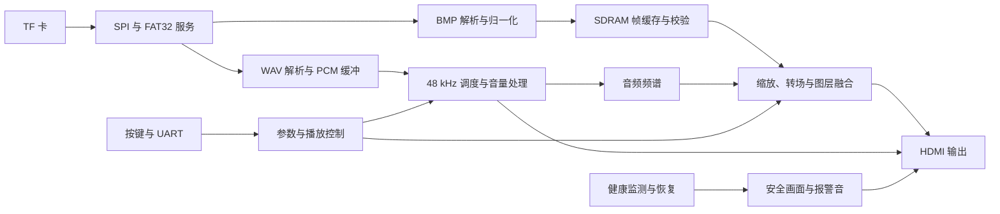

# 模块与数据流

板级入口是 `safevision/platform/anlogic_eg4s20_hx4s20c/rtl/safevision_top/safevision_v3_top.v`。顶层装配媒体、显示、音频和控制模块，并连接时钟与复位。BASE 与 HD 各有一份有序源文件清单。

## 模块职责

| 目录或模块 | 职责与接口约定 |
| --- | --- |
| `rtl/storage/` | SPI、FAT32、目录与簇链访问；数据以有效、就绪、完成及错误信号交付 |
| `rtl/media/` | 解析 BMP/WAV，将图片归一化并产生坐标、帧起止和像素有效信号 |
| `rtl/memory/` | 帧写入、事务调度、行校验和缓存管理；地址、长度与数据握手一起检查 |
| 板级 `sdram_app_adapter.v` | 将应用事务转换为厂商 SDRAM 接口时序 |
| `rtl/video/` | 行缓存、缩放、Alpha 融合、Fade、HUD、计时、字幕和频谱显示 |
| `rtl/audio/` | PCM 环形缓冲、跨域传输、采样调度、音量、报警音及 HDMI ACR |
| `rtl/control/` | 按键消抖、串口命令、参数提交、健康监测和恢复状态机 |

主要功能入口：

| 功能 | 入口 |
| --- | --- |
| 目录扫描与媒体选择 | [`sd_bmp_player.v`](../safevision/rtl/storage/sd_bmp_player.v)、[`v3_flexible_media_index.v`](../safevision/rtl/storage/v3_flexible_media_index.v) |
| 图片格式与尺寸检查 | [`bmp_parser.v`](../safevision/rtl/media/bmp_parser.v) |
| 显示装配 | [`v3_video_display_core.v`](../safevision/rtl/video/v3_video_display_core.v) |
| 中文滚动提示 | [`v3_scrolling_ticker.v`](../safevision/rtl/video/v3_scrolling_ticker.v) |
| 频谱计算与绘制 | [`v3_audio_spectrum.v`](../safevision/rtl/video/v3_audio_spectrum.v) |
| 音频播放与缓冲 | [`v3_audio_system.v`](../safevision/rtl/audio/v3_audio_system.v) |
| 按键菜单与参数 | [`v3_user_controls.v`](../safevision/rtl/control/v3_user_controls.v) |
| 健康状态与恢复 | [`v3_supervisor.v`](../safevision/rtl/control/v3_supervisor.v)、[`media_recovery_ctrl.v`](../safevision/rtl/control/media_recovery_ctrl.v) |

## 帧和音频提交

四个图片槽在装载、校验后进入有效状态。播放控制选择目标槽，显示通路在帧边界提交；转场期间保留有效画面。图片和音频使用同一 generation 标识，避免切图时继续使用上一代音频数据。

图层在像素时钟域内保持固定流水延迟。增加图像处理级数时，应同时移动坐标、有效、同步和图层标签，运行完整帧参考模型回归。

频谱模块采集 512 个左声道样本，去除块均值并加窗，再计算定点 FFT。采样率为 48 kHz 时，频点间隔为 93.75 Hz。模块将频点幅值归入 32 个显示频段；计算结果写入后台缓存，在 `frame_start` 时交换显示缓存。字幕字库与频谱共用存储端口，计算状态机在显示访问期间让出端口。

## 时钟与跨域

媒体访问、存储、像素扫描和音频调度使用各自的时钟域。异步时钟域之间的数据通过异步 FIFO 或请求/应答邮箱传递，单比特状态经过同步器。相关时钟域的数据通路按实际频率与相位关系保留时序检查。参数先在控制域接收，再在显示域按约定边界生效。

BASE 顶层以 50 MHz 驱动媒体与存储通路，`sys_clk` 选择存储时钟。像素频率参数为 25,185,185 Hz；HD 对应参数为 74,166,667 Hz，`sys_clk` 选择 100 MHz。PLL 的实际配置和关联时钟约束位于板级工程中。

`video_cdc_mailbox` 的发送端只在 `src_valid && src_ready` 时接收数据。负载寄存器保持到接收端应答返回；接收端同步请求后先等待一拍，再锁存负载并置位 `dst_valid`。`dst_valid && dst_ready` 完成消费并翻转应答。邮箱一次只容纳一笔在途事务，调用方应遵守 `ready` 握手。`v3_cdc.sdc` 对邮箱负载路径设置 8 ns 的数据通路最大延迟。

PLL、物理管脚和时序约束位于板级目录。生产工程通过 `v3_board_sources.list`、`v3_board_sources_hd.list` 和 `v3_board_assets.list` 明确加载依赖；行为模型由仿真清单选择。

## 共享文件服务接口

`sd_bmp_player` 和音频文件源复用 `v3_shared_fs_service`。接口使用同一 `ref_clk` 域内的打包信号，`core_cmd` 为 445 位，`core_rsp` 为 837 位。字段按 Verilog 拼接顺序从高位向低位排列。

| 命令位段 | 内容 |
| --- | --- |
| `[444:439]` | 内核复位、目录启动与就绪、文件上下文装载、文件使能及启动 |
| `[438:375]` | 文件首簇和字节数，各 32 位 |
| `[374]` | 文件数据就绪 |
| `[373:109]` | 265 位文件流上下文 |
| `[108:42]` | 簇链上下文装载、跳数、复位、启动及当前簇 |
| `[41:24]` | 三路 SD 客户端的 ready、valid、last、done、timeout、CRC 状态，各 3 位 |
| `[23:0]` | SD 数据、错误码、错误详情，各 8 位 |

| 响应位段 | 内容 |
| --- | --- |
| `[836:554]` | 目录扫描状态、目录项、SD 读取及簇链请求 |
| `[553:138]` | 文件流状态、数据、上下文、SD 读取及簇链请求 |
| `[137:0]` | 簇链遍历状态、下一簇、错误与 SD 读取请求 |

字段的打包、解包分别位于服务模块、图片源和音频源。修改字段时需同时核对各端位宽与顺序，并运行共享存储和媒体回归。

## 故障与复位

媒体通路的恢复分为复位、稳定等待、重扫和重新提交。超时或失败进入安全状态，恢复次数由控制器限制。安全画面使用片上字库和图形逻辑，报警音来自片上 ROM，媒体复位期间仍可输出应急信息。

`media_recovery_ctrl` 的 `request` 进入一次恢复，`busy` 覆盖复位、稳定等待、重扫和结果等待。重扫请求 `rescan_start`、成功通知 `recovered` 均为单拍脉冲。默认最多尝试三次，成功后清零尝试次数；失败、超时或 `fatal` 将状态保持在安全侧。`PROGRESSIVE_WAIT` 开启时，`progress` 会重新计时，超时按连续无进展时间判断。

`reset_sync` 异步置复位，经至少两级寄存器同步释放。存储域使用 `RELEASE_FALLING=1`，在同步管线释放后由下降沿寄存器输出复位信号。

复位修改需要检查释放时钟域、缓存失效、generation 和在途事务。恢复回归会核对复位边界、请求/忙/完成接口和失败后的安全状态。
