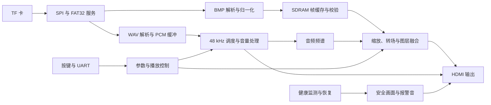

# 模块与数据流

板级入口是 `safevision/platform/anlogic_eg4s20_hx4s20c/rtl/safevision_top/safevision_v3_top.v`。顶层连接时钟、复位、媒体加载、显示和音频通路，具体算法放在各自模块内。BASE 与 HD 分别使用有序源文件清单选择实现。

## 模块职责

| 目录或模块 | 职责与接口约定 |
| --- | --- |
| `rtl/storage/` | SPI、FAT32、目录与簇链访问；数据以有效、就绪、完成及错误信号交付 |
| `rtl/media/` | 解析 BMP/WAV，将图片归一化并产生坐标、帧起止和像素有效信号 |
| `rtl/memory/` | 帧写入、事务调度、行校验和缓存管理；地址、长度与数据握手一起检查 |
| 板级 `sdram_app_adapter.v` | 将应用事务转换为厂商 SDRAM 接口时序 |
| `rtl/video/` | 行缓存、缩放、Alpha 融合、Fade、HUD、计时、字幕和频谱显示 |
| `rtl/audio/` | PCM 环形缓冲、跨域传输、采样调度、音量、报警音及 HDMI ACR |
| `rtl/control/` | 按键消抖、串口命令、参数提交、健康监测和恢复状态机 |

修改具体功能时，可从以下文件进入：

| 功能 | 入口 |
| --- | --- |
| 目录扫描与媒体选择 | [`sd_bmp_player.v`](../safevision/rtl/storage/sd_bmp_player.v)、[`v3_flexible_media_index.v`](../safevision/rtl/storage/v3_flexible_media_index.v) |
| 图片格式与尺寸检查 | [`bmp_parser.v`](../safevision/rtl/media/bmp_parser.v) |
| 显示装配 | [`v3_video_display_core.v`](../safevision/rtl/video/v3_video_display_core.v) |
| 中文滚动提示 | [`v3_scrolling_ticker.v`](../safevision/rtl/video/v3_scrolling_ticker.v) |
| 频谱计算与绘制 | [`v3_audio_spectrum.v`](../safevision/rtl/video/v3_audio_spectrum.v) |
| 音频播放与缓冲 | [`v3_audio_system.v`](../safevision/rtl/audio/v3_audio_system.v) |
| 按键菜单与参数 | [`v3_user_controls.v`](../safevision/rtl/control/v3_user_controls.v) |
| 健康状态与恢复 | [`v3_supervisor.v`](../safevision/rtl/control/v3_supervisor.v)、[`media_recovery_ctrl.v`](../safevision/rtl/control/media_recovery_ctrl.v) |

## 帧和音频提交

四个图片槽在装载、校验后进入有效状态。播放控制选择目标槽，显示通路在帧边界提交；转场期间保留有效画面。图片和音频使用同一 generation 标识，避免切图时继续使用上一代音频数据。

图层在像素时钟域内保持固定流水延迟。增加图像处理级数时，应同时移动坐标、有效、同步和图层标签，运行完整帧参考模型回归。

## 时钟与跨域

媒体访问、存储、像素扫描和音频调度使用各自的时钟域。异步时钟域之间的数据通过异步 FIFO 或请求/应答邮箱传递，单比特状态经过同步器。相关时钟域的数据通路按实际频率与相位关系保留时序检查。参数先在控制域接收，再在显示域按约定边界生效。

PLL、物理管脚和时序约束位于板级目录。生产工程通过 `v3_board_sources.list`、`v3_board_sources_hd.list` 和 `v3_board_assets.list` 明确加载依赖；行为模型由仿真清单选择。

## 故障与复位

媒体通路的恢复分为复位、稳定等待、重扫和重新提交。超时或失败进入安全状态，恢复次数由控制器限制。安全画面使用片上字库和图形逻辑，报警音来自片上 ROM，媒体复位期间仍可输出应急信息。

复位修改需要检查释放时钟域、缓存失效、generation 和在途事务。恢复回归会核对复位边界、请求/忙/完成接口和失败后的安全状态。
