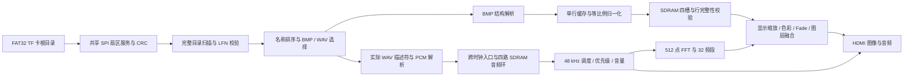
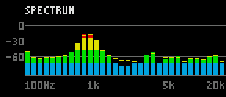

# BASE 任意名称 BMP 与 PCM 频谱

本说明对应 `26102301` 固件。旧 `26102237` 候选因实板行完整性故障已被撤回，不能继续作为下载版本。是否允许下载以匹配源码提交的功能审计、布局布线、原始时序报告及位流清单为准；本说明本身不代表验收通过。生产写缓存时钟与修复依据见 [写通路修正记录](../changes/BASE_WRITE100_REPAIR_261023.md)。

## 使用约定

TF 卡采用 FAT32，图片放在根目录。无需使用 `SV0001` 这样的固定编号。支持合法的 FAT 长文件名，包括中文和 UTF-16 名称；长文件名序列或校验和损坏时，使用实际的 8.3 短名。程序完整比较名称，不使用可能发生碰撞的名称哈希。

排序按 UTF-16 无符号代码单元逐个比较，只将 ASCII `a-z` 折叠为大写。这是确定的字典顺序，不采用 Windows 区域排序或数字自然排序。例如 `SV001.BMP`、`SV0010.BMP` 均排在 `SV002.BMP` 前面。超过四张有效图片时取排序后的前四张，不能假定取最后复制的四张。损坏或不支持的 BMP 被跳过；至少需要四张合法图片才能批准四槽播放。

有合法 LFN 时比较原始 UTF-16；没有合法 LFN 时比较实际 8.3 别名的字节，每个字节零扩展为一个比较单元。FAT 短名采用写卡系统的 OEM 字符集，本实现不猜测该代码页，也不把没有 LFN 的传统多字节短名自动转换成 Unicode。因此这种短名的排序按原始字节确定，不能描述为 Windows 显示名称的区域排序。FAT 字符集差异参见 [Microsoft 文件名字符集说明](https://learn.microsoft.com/en-us/windows/win32/intl/character-sets-used-in-file-names)。

| 项目 | 实现范围 |
| --- | --- |
| 图片编码 | BMP，24 位 BGR 或 32 位 BGRX，BI_RGB；32 位的第四字节忽略 |
| 图片尺寸 | 每一轴 1–16384 像素；支持正高度和负高度 |
| BMP 结构 | 正确的文件/像素长度、单平面、完整 DIB 头、合法像素偏移和行填充 |
| BASE 输出 | 640×480，居中等比例适配，剩余区域为黑边 |
| 源图归一化 | RGB565、整数坐标最近邻；原显示端的最近邻/双线性缩放选项继续保留 |
| 不支持的图片 | 调色板、RLE、BI_BITFIELDS、JPG/PNG、超过边界或截断文件，安全拒绝 |
| 目录边界 | 根目录最多扫描 65535 个实体项；越界报告错误，禁止序号回绕 |

例如 480×800 竖图在左右留黑边，1280×720 或 1920×1080 横图在上下留黑边。放大单像素图仍填满符合其比例的区域；透明度、32 帧 Fade、亮度、对比度、应急恢复和手动切换接口沿用原实现。

配音首先查找完整同名主干的 WAV；没有完整同名文件时，按轮播槽使用稳定目录顺序中的 WAV，文件较少时回到首个。三位和四位数字名称没有额外优先级，例如 `SV001.BMP` 不会仅因数字相同优先匹配 `SV0001.WAV`。WAV 还要经过真实 RIFF/PCM 解析；坏文件不能只凭扩展名算作可播放。选中音频解析失败时有界尝试目录内其他候选，穷尽才使用内置提示音。音频格式边界沿用 PCM WAV 解析器。

## 模块和提交边界

| 模块 | 职责及接口 |
| --- | --- |
| `v3_fat_name_store` | REF 时钟；校验 LFN 顺序/校验和，保存完整 UTF-16 名称；`busy` 对扫描字节流反压 |
| `fat32_directory_scanner` | 输出冻结的目录项和名称读口；`ent_valid` 保持到 `ent_ready` |
| `v3_flexible_media_index` | 一次完整根目录扫描选一个最小候选，第二次扫描选伴音；名称保存在两银行 RAM |
| `bmp_parser` | 检查尺寸、编码、DIB、偏移及 33 位长度和，防止整数回绕 |
| `v3_bmp_normalizer` | 单行 RGB565 缓存和整数 DDA，逐像素居中适配；完整消费并验证源文件尾部 |
| `sd_bmp_player` | 仅在 BMP 及 SDRAM CRC 批准后提交槽；拒绝文件同样推进排序游标 |
| `v3_wav_source` | 用已有上下文 RAM 接收伴音描述符，保持格式检查、碎片簇链、PCM 环缓冲和失败回退 |
| `safevision_v3_top` | 连接描述符 `valid/ready/slot/data/found`，统一媒体复位及图音 generation |
| `v3_audio_spectrum` | PIXEL 时钟；观察实际 HDMI PCM，完成 FFT 和频段发布；不反压播放链 |

描述符为 `{WAV字节数[31:0], 首簇[31:0]}`，发送方保持所有字段直至握手。四个描述符均写入后，音频端才允许索引完成。媒体恢复清除描述符有效状态，必须重新扫描和批准，不能复用旧卡的地址。

FLEX 模式的 16 位 cache key 表示实体目录项索引加一，用于槽身份和完整性检查，不再表示文件名里的数字。`B:IDLOW?` / `B:IDHIGH?` 可读回四槽 key，但不能据此还原中文名称；伴音地址必须来自上述实际描述符，禁止再由 key 拼出 `SVdddd.WAV`。旧模式保留原编号接口，避免破坏已有基线。

目录、BMP/WAV 文件流和入口写侧由 REF 域负责；SDRAM 请求和环缓冲位于 MEM 域；48 kHz 调度、优先级仲裁和音量运算位于 AUDIO 域。处理后的 PCM 通过音频包 FIFO 进入 PIXEL 域，由 HDMI 接口及频谱观察器共同使用；视频处理也在 PIXEL 域进行。数据跨域使用已有异步 FIFO 和描述符握手，不把多位总线各自同步后直接拼成数据。加载、播放和错误恢复各自有清晰的有效标志；图像和伴音最终按同一 generation 提交，不能仅凭文件名已被选中就提前切换。

目录扫描只在完整完成后才允许候选提交。超时、CRC 错误或簇链错误必须终止本次扫描；即使此前已经看到合法图片，也不能把部分目录当成排序完成。

存储器读地址只有在读使能有效时才有事务含义。优化后的共享服务可以在空闲周期改变未使能的地址，不能把这些空闲地址当作实际内存读取；有效读的地址、延迟和数据仍按原接口逐拍检查。旧模块的全部位置式端口保留原顺序，新增可选端口追加在末尾。

预索引播放使用 512×16 位的跨时钟音频入口队列，默认兼容实例继续使用 1024×16 位；四路 SDRAM 音频环缓冲容量均保持 16384 个立体声样本对。每个样本对以两个数据字和一个槽标签字送入队列，只有第三个字握手后才对上游确认。一个完整 512 字节 PCM 扇区最多占 384 个队列字；入队前在完整分组边界核验剩余空间，额外保留七个字的保护余量。该队列针对有界预填和持续播放设计，四路永久停止消费不属于正常播放条件，不能将其描述为通用无阻塞交换网络。扇区空间判断、满反压、环绕、半组复位、默认实例兼容性及真实四路环缓冲联动均有独立验证。

生产顶层启用进展式加载监控。启动的 60 秒预算以及恢复 WAIT 的 4.9 秒预算计算“没有实际媒体或内存进展”的时间；持续读取合法大图可以超过该总时长。单独的视频心跳不能延长加载，视频、内存和媒体各自的失活监控也继续独立工作。失败和致命故障仍优先处理，三次恢复上限保留；SAFE 画面在等待期间持续有效。大图加载速度受文件大小和 TF 读取速度限制。

## 频谱显示

输入是音量调节和优先级仲裁后的实际左声道 HDMI PCM。每块 512 个样本先减均值、加周期 Hann 窗，再做九级 radix-2 FFT。每级缩放一半，使用共享的乘法器和片上存储，避免并行铺开全部蝶形。旋转系数采用四分之一正弦表，正负号和端点从索引恢复。

48 kHz 采样下，每个 FFT 频点约 93.75 Hz。直流频点排除，正频率划分为 32 个频段；频段高度来自该频段 FFT 幅值的对数映射。屏幕包含频率标记、参考幅度刻度、四色频谱和峰值保持。它表示不同频率上的能量分布，不是将一个总音量值复制为多根柱。

计算和显示使用不同的银行，完整频谱仅在帧边界发布。计算期间仍显示上次完整结果；观察器在处理 FFT 时跳过新样本，播放时钟和 PCM 流不会等待它。这个离散更新频谱不用于精密声学校准。

`v3_status_layers` 将分析器的一拍像素输出与其余图层对齐。经过状态层、HUD 缓冲、既有精确 alpha 调色板和最终 RGB 输出，总路径为 21 拍。频谱仅使用已验证的白、青、绿、黄、红调色板，避免在实机中产生错误颜色。

频谱位于画面右下方，带有 `SPECTRUM` 标题和 100 Hz、1 kHz、5 kHz、20 kHz 参考标签。静音后频段逐步衰减，峰值保持线延后下降；单一正弦提示音通常只在少量频段有稳定峰值，这属于正确的频率响应。持续纯音不会像随机动画一样让全部频段跳动。该显示观察左声道；仅右声道有信号的音频不会在左声道频谱中产生峰值。

下图来自 BASE 整机测试实际保存的最终 RGB 输出，完整区域为 288×124 像素，经过音频样本 FIFO、FFT、状态层、HUD 调色板和 21 拍最终输出路径。测试将前一图片图层固定为黑色，以便逐像素核对；这是一张仿真图，不是开发板屏幕照片。原始像素文件保留在 `tb_v3_feature_board_base198` 的验收证据中，图像来源 SHA 见同目录旁的 provenance JSON。

## 验证与交付记录

必须分别保留以下证据，不能互相替代：

1. 独立主机模型产生的完整名称顺序、BMP 全帧像素及 FFT 数值参考；包含中文、长名、大小写、不同尺寸和坏文件。
2. 真实扫描器、共享 SPI 服务、四槽图片缓存和实际 PCM 的联合仿真；包含目录末项、反压、碎片簇链、尾流截断和回退。
3. 正常结束并检出错误的语义故障注入；编译失败、仿真崩溃、超时和跳过不能计为通过。
4. 冻结同一物理源文件和约束后重新综合、布局布线，核验实际芯片容量、Slow/Fast setup/hold/recovery/removal 及管脚/CDC/ROM。
5. 位流 SHA-256、源码提交、工具版本和构建参数；自动 SRAM 下载日志及固件 ID 回读。
6. 实卡四槽、播放 generation、错误计数和自动轮播的串口记录，以及实体显示器上的比例、文字方向、菜单、频谱和声音确认。

旧波形模块及其独立测试保留，便于兼容性复核；生产顶层启用 `FLEX_SPECTRUM=1`。历史测试名中的 `wave` 不能据此推断当前生产仍显示波形，应查看本次实际编译图与顶层参数。

本阶段仅批准 BASE 的目标工作，HD 是否通过需另行提供完整物理证据。GitHub 上传遵循用户当前指令，默认不执行；本地项目更新必须保留既有验收包及用户未提交文件。

## 操作检查

1. 将至少四张上述格式的 BMP 放在 FAT32 根目录。保留的旧图片也参与名称排序；例如 `10.BMP` 会排在 `2.BMP` 前，中文按 UTF-16 代码单元顺序比较，不按拼音排列。
2. 有配音时优先放置完整同名主干 WAV，例如 `风景一.BMP` 对应 `风景一.WAV`。缺少同名配音时使用卡内目录序号回退；没有可用音频仍能用内置提示音播放。
3. 使用本次清单中明确批准的 BASE 位流下载 SRAM，保持供电。更换卡片后按 KEY1/RESET 重新扫描；CONFIG1 和断电会加载 Flash 中原有程序。
4. 默认每五秒轮播。检查竖图左右黑边、宽图上下黑边、文字方向和圆形比例；左下 `UP … s` 每秒递增，右下显示当前左声道频谱。
5. KEY2+KEY3 同时长按约两秒进入菜单，松开后短按 KEY2/KEY3 增减当前参数，长按 KEY2 切换参数，长按 KEY3 退出。亮度和对比度数值变化应与画面变化一致。
6. 串口必须读回本次固件 ID、四槽有效、默认轮播及零完整性/溢出/欠载错误。串口合格与实体显示、声音的确认分别记录，不能互相代替。

## 2026-10-23 BASE 时序修正

BASE 控制域使用已有内存 PLL 的 50 MHz 输出，HD 控制域保持 100 MHz；没有更改 PLL 参数或真实时钟约束。串口、20 ms 消抖、按键菜单、毫秒时间基准、100/200/500 ms 看门狗，以及 60 s 启动和 4.9 s 恢复无进度期限，都显式按实际 SYS_HZ 换算。

板级行完整性观察将事务有效位、地址、数据和帧元数据统一延后一拍；真实 SDRAM 写请求/接受握手不变。生产 packed cache 通过 READ_PIPELINE=1 将读回数据及有效位统一暂存，CRC、写行、字计数和进度使用同一拍；默认参数为0，保留旧接口周期。FLEX 几何计算将宽比较与提交分为两拍，每张最多增加640个REF边沿，最终尺寸、黑边、方向和像素序列不变。

物理源码821535a2900eea9951a8c399a6a7f128bc25f852已经完成实际BASE布局布线和Slow/Fast时序：setup +0.070ns、hold +0.037ns、recovery +3.382ns、removal +0.023ns。原始门禁为native803/base/timing.gate.json，2958条报告路径中无负路径。此结论只批准该物理源码的时序，不能替代正在运行的完整功能回归、位流绑定或真实板测。

强制辅助证据另包含原子事务/CRC、新缓存与独立原周期参考、完整视频像素及几何等号边界；四项语义故意破坏必须正常结束并被检出。当前完整303/221回归及所有附加门禁完成后才能生成发布位流。

## 诊断注入与计数器负控的回归修正

旧诊断测试通过顶层连续赋值别名强制 source_words=153600，该强制也作用于行完整性计数器；新增的冗余 source_first 仍为1，因而触发一致性断言。两个诊断测试现在配对注入 source_first=0，保持这个非零计数场景一致。全部原有协议、范围、媒体复位、背压、事件时间戳及1000个高位别名检查继续执行；两个正向与五项语义负控均正常结束并通过各自预期。生产RTL和断言没有修改。

“frame_counter_one_bit_short”负控原先会被新增的一致性断言提前停止，按验收规则不能算作正常检错。更新后的故障模型仍缩短同一个计数器一位，同时让冗余零标志与这个错误计数器保持一致；原有断言保留，独立公共接口参考发现六次计数回绕错误并正常结束。这个修改仅发生在故意破坏的副本及负控定义中，不进入综合源文件。原始失败日志、原测试文件和原负控定义完整保留。

主矩阵仍为303个独立正向顶层和221个语义负控。最终选择215份当前版本的新执行记录、重新核验309份输入未变的原始记录；主矩阵及上述重试共223次原生执行尝试，其中8次原始失败尝试保留，未计为通过。其余强制辅助验证单独记录。最终是否完成以功能审计和发布清单为准。
