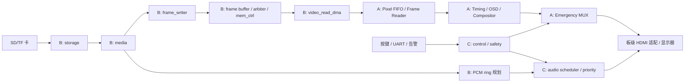

# 系统架构与依赖方向

依据：手册 V2.0 §2.2–2.4、§6–8、§10–12；现有 `docs/interface_spec.md` 为 B 链实际接口基线。图是目标系统，不表示所有模块已实现。

## 依赖规则

1. `rtl/top/safevision_core/safevision_core.v` 装配业务链，只引用 `rtl/` 内模块和抽象端口；不含 FPGA 引脚、厂商原语、PLL/SDRAM/HDMI IP。
2. `platform/anlogic_eg4s20_hx4s20c/rtl/safevision_top/safevision_top.v` 接板级引脚、时钟复位、IP 适配器和 `safevision_core`。板级工程通过 `build/manifests/` 中明确的文件表选源，不用无边界的目录通配。
3. `storage/media/memory` 不反向例化 `video/control/safety`。跨链只经 `docs/interface_spec.md` 的命名接口与顶层连接；A/B/C 各自能用模型单跑。
4. `mem_ctrl.v` 当前是**逻辑字节地址→SDRAM 字地址**的业务侧 wrapper，行为模型在 `verification/models/frame_memory_model.sv`（SD 侧另有 `verification/models/sd_spi_card_model.sv`）；真实 SDRAM PHY/IP 的接线和约束归 `platform/`。不要把行为模型通过仿真误写成已上板。
5. `video_read_dma.v`、`frame_swap_ctrl.v`、`frame_swap_cdc.v` 已由 B 提供，继续留在 `rtl/memory/`；A 侧 `frame_reader` 消费像素并与扫描标签对齐。接口所有权由 A/B 共同签收，变更先改规范。

## 时钟、CDC、复位

手册给出 `board_clk`、`sys_clk`、`mem_clk`、`pixel_clk`、`serial_clk`、`audio_clk` 的目标域，频率需以最终 PLL、STA 和板级实测为准。稳定单 bit 电平两级同步；事件用 toggle/ack；多 bit 配置用保持载荷的 mailbox；连续像素/音频用异步 FIFO。各域复位同步释放，媒体复位不能把视频时序、安全画面、HDMI PHY 和故障首因一起清掉。跨域清单和复位行为在接口文档逐条记录。

目前 `platform/.../rtl/clock/` 实现 `reset_sync.v` 与 `clock_reset_ctrl.v`，只处理锁定许可和分域复位；安路 PLL IP、时钟模式切换、板级约束仍待建立。

## 显示与安全边界

HDMI 是固定速率消费端，欠载时保持 `hsync/vsync/de` 几何时序并输出安全像素，`pixel_valid` 表示数据有效，两者不能混同。Frame Reader 要在有效区之前预取并登记全链延迟。片上安全画面存字模/图标/参数，按坐标实时生成，不假定片上保存整帧。安全承诺限于定义的媒体路径故障；PLL、电源或 HDMI 物理层故障另列为边界。

## 帧生命周期

`frame_writer` 完成写入与校验 → `frame_buffer_manager` 标记可用槽 → B 锁存 `slot_id/generation/crc_ok` → `swap_req` toggle → A 在垂直消隐期采纳并回 `swap_ack` → 旧槽释放。超时保留旧槽并报错。此链需在接口测试和板级波形中共同证明，不能只凭静态目录或单元 TB 宣称无撕裂。
