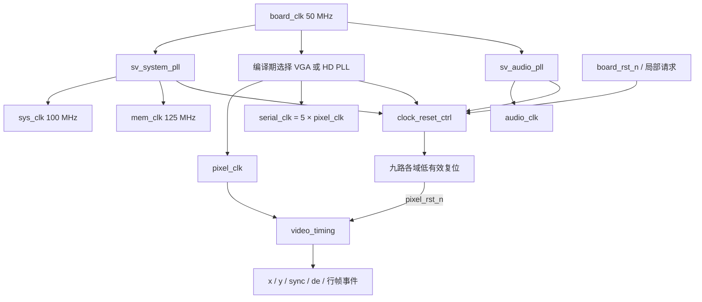

> 历史阶段记录，版本、参数与结论按原记录日期理解。当前 BASE 的模块和验收状态见仓库首页。

# 本次 A 独立发布范围

> [更新 2026-10-04] 下文的 USR-6135 开放状态属于历史构建。`a1dba93` 已修正四个 PLL 的 C0 反馈连线及系统 C2 缓冲；本次 SDRAM 回环图案/报告缓存修正版复验未再出现 USR-6135、PHY-5079。SDRAM setup −6.826 ns 仍开放，不能登记为整板时序通过。当前说明见 [SDRAM/PLL 核查修正版](B链-SDRAM接口与PLL时序核查.md)。

本文件技术说明用于 A Clock/Timing。当前新回归与B不变核对见 [A_PUSH_SCOPE_20261002.md](A_PUSH_SCOPE_20261002.md)。下列旧归档路径记录过滤前完整工作树；A 的TD源码输入未变，B默认超时试验没有推送。

# Clock / Reset / Video Timing 实现与接线说明

版本：2026-10-02。模块源码与官方 IP 已交付，五项 XSim 和整数 PLL 审计通过；TD 两种模式受分析的内部时序满足要求，健康告警仍未闭合。源码、IP 和结果以交付清单及原始日志为准，硬件验收未进行。

## 1. 本次交付承担什么

这部分给 SafeVision 提供三个基础能力：从板载 50 MHz 参考时钟产生五个业务时钟；按 PLL 锁定状态和局部重启请求产生九路复位；在像素时钟域连续产生行场扫描坐标、同步、有效区和帧行事件。

模块按仓库原有分类放置。可移植扫描逻辑在 `safevision/rtl/video/video_timing/`，模式常量在 `safevision/rtl/include/`；与 EG4S20 器件相关的 PLL、时钟包装、复位控制和 TD 工程在 `safevision/platform/anlogic_eg4s20_hx4s20c/`。测试在 `safevision/verification/unit/`，运行入口在 `safevision/tools/`。本次没有迁移原 B 链目录。

依据为用户提供的《安视 SafeVision 赛题一对标学习与开发手册 V2.0》的 A 分工、时钟/扫描章节、帧交换章节，以及仓库的接口规范、模块登记、Verilog-2001 和目录约定。手册示例若与项目已经冻结的跨链契约冲突，按本说明登记原因并修正。

### 1.1 代码模块清单

| 文件 | 来源与本次状态 | 作用 |
|---|---|---|
| `rtl/include/video_mode_defs.vh` | 新增公共头 | 保存两种扫描模式的 porch、同步宽度、极性和标称像素频率；与帧缓存几何分开 |
| `rtl/video/video_timing/video_timing.v` | 新增可综合 RTL | 连续扫描计数及全部同拍扫描标签；没有厂商原语 |
| `platform/.../rtl/clock/clock_gen.v` | 新增可综合包装 | 接四份官方 PLL 配置中的三颗实际 PLL，输出五路业务时钟和锁定许可 |
| `platform/.../rtl/clock/clock_video_subsystem.v` | 新增板级子系统 | 将时钟、分域复位、扫描逻辑接在一起；同一个参数同时选择 PLL 和扫描模式 |
| `platform/.../rtl/clock/reset_sync.v` | 既有 RTL，局部加固 | 单域异步断言、同步释放；增加参数下限检查和保留同步链的属性 |
| `platform/.../rtl/clock/clock_reset_ctrl.v` | 复用既有 RTL | 把板级复位、四个锁定许可和四类局部请求组合成九路复位 |
| `platform/.../ip/pll/sv_system_pll.v` / `.ipc` | TD 官方生成 | 50 MHz → 100 MHz `sys_clk`、125 MHz `mem_clk` |
| `platform/.../ip/pll/sv_video_vga_pll.v` / `.ipc` | TD 官方生成 | BASE 视频时钟，pixel 与 serial 严格保持 1:5 |
| `platform/.../ip/pll/sv_video_hd_pll.v` / `.ipc` | TD 官方生成 | HD 视频时钟，pixel 与 serial 严格保持 1:5 |
| `platform/.../ip/pll/sv_audio_pll.v` / `.ipc` | TD 官方生成 | 音频 MCLK；实际频率与标称 12.288 MHz 分别记录 |

表中 `rtl/` 相对于 `safevision/`；`platform/.../` 完整前缀为 `safevision/platform/anlogic_eg4s20_hx4s20c/`。PLL `.v` 保留厂商版权及生成注释，`.ipc` 保存向导配置。修改频点须重新生成、重新仿真和重新分析时序。

### 1.2 接线关系



`clock_video_subsystem` 包含以上装配；它是 A 的基础子系统。产品级 `safevision_top` 还需要接引脚、SDRAM、FIFO、Frame Reader、应急画面和 HDMI PHY。

## 2. 时钟：目标频率、官方参数和实际频率

### 2.1 选择方式与极性

`clock_gen` 的 `VIDEO_MODE_HD` 只能是编译期常量 0 或 1。0 例化 BASE PLL，1 例化 HD PLL。一次构建实际使用系统、选定的视频、音频共三颗 PLL；磁盘上的四份配置不代表同时使用四颗 PLL。

板级 `board_rst_n` 低有效，官方 PLL 的 `reset` 高有效，包装中显式连接 `reset = ~board_rst_n`。系统和存储时钟来自同一系统 PLL，因此 `sys_pll_locked`、`mem_pll_locked` 是同一 `extlock` 的两个接口名字。每个业务域仍分别同步释放复位。

视频 PLL 的 C0 为正常外反馈，C1 为 pixel，C2 为 serial。音频 PLL 的 C0 为反馈，C1 为 audio。反馈输出不是额外的业务时钟，不能因“没有业务使用”而删掉其连接。PLL 失锁会使对应复位断言；锁定信号本身不能代替频率测量或时序验收。

### 2.2 参数计算

为避免不同资料把 M/N 名字反过来，本文直接使用生成代码中的名字：`r = REFCLK_DIV`，`m = FBCLK_DIV`。当前 NORMAL / CLKC0_EXT 反馈配置为：

```text
Fref = 50 MHz
分频后参考频率 = Fref / r
Fvco = Fref × m × C0 / r
业务输出 Fi = Fvco / Ci
ppm = (实际频率 / 标称频率 − 1) × 1,000,000
```

| 配置 | r | m | C0 | 业务分频 | 分频后参考 MHz | VCO MHz | 业务频率 MHz |
|---|---:|---:|---:|---|---:|---:|---|
| system | 1 | 2 | 10 | C0=10；C1=8 | 50 | 1000 | sys=100；mem=125 |
| VGA | 3 | 17 | 4 | C1=45；C2=9 | 16.666667 | 1133.333333 | pixel=25.185185185；serial=125.925925926 |
| HD | 4 | 1 | 89 | C1=15；C2=3 | 12.5 | 1112.5 | pixel=74.166666667；serial=370.833333333 |
| audio | 2 | 1 | 29 | C1=59 | 25 | 725 | audio=12.288135593 |

TD 向导使用 EG4S20BG256、50 MHz 输入、NORMAL 反馈、高有效 reset 和 extlock。上述分频后参考频率均在向导要求的 10 至 400 MHz 内，VCO 在官方 PLL 指南给出的 300 至 1200 MHz 内。还需由目标器件的综合、布局布线、时序报告确认实际资源和实现限制。

| 时钟/帧 | 手册标称 | 本配置实际值 | 相对频差 |
|---|---:|---:|---:|
| BASE pixel | 25.175 MHz | 25.185185185 MHz | +404.575 ppm，约 +0.04046% |
| BASE serial | 125.875 MHz | 125.925925926 MHz | +404.575 ppm |
| HD pixel | 74.25 MHz | 74.166666667 MHz | −1122.334 ppm，约 −0.11223% |
| HD serial | 371.25 MHz | 370.833333333 MHz | −1122.334 ppm |
| audio MCLK | 12.288 MHz | 12.288135593 MHz | +11.035 ppm |
| BASE 帧率 | 25.175M / (800×525) ≈59.940476 Hz | ≈59.964727 Hz | 与像素时钟同相对频差 |
| HD 帧率 | 60 Hz | ≈59.932660 Hz | 与像素时钟同相对频差 |
| MCLK/256 样率 | 48000 Hz | ≈48000.529661 Hz | +11.035 ppm |

`video_mode_defs.vh` 中 `*_PIXEL_CLK_HZ` 是手册标称模式频率，扫描 RTL 不用它产生时钟。生成配置的实际频率见 PLL 文件和本表；不能拿宏中的标称值当作已经实现的测量值。以上数字来自整数比例计算，不包含板载晶振误差、抖动和硬件测量误差。

### 2.3 为什么不填写“精确 25.175 / 74.25 / 12.288 MHz”

50 MHz 输入下，当前整数分频与参考范围不能精确形成这三个标称值。用整数关系可检查：`Fi/50 = (m×C0)/(r×Ci)`。参考下限要求 `r≤5`，VCO 上限要求 `Ci≤floor(1200/Fi)`；约分后的目标分母分别为 VGA 2000、HD 200、audio 3125，而 `r×Ci` 分别最多 235、80、485，不可能包含这些约分分母。

因此本版记录可生成的实际频点并保持视频 5:1 比例。它不构成显示器接受性、HDMI 合规或音频长期缓冲稳定性的证明。若最终验收要求标称频率精确实现，需要评估不同参考频率或器件支持的另一种官方时钟方案，并重新生成与验证；不能在注释中把近似值改写成精确值。HDMI 音频 ACR、样率节拍和环形缓冲预算后续必须使用实际频率。

`safevision/tools/check_pll_profiles.py` 用 Python 标准库 Fraction 解析官方 Verilog 参数并进行完整整数空间枚举，检查当前范围和视频 5:1，已实际运行通过。工具还核对 `.ipc` 的器件、NORMAL/CLKC0 反馈、reset/lock、Medium、输入频率、REF/FB/C0/C1/C2、输出频率及零相移与 `.v` 一致。181 个去重合法 VCO 经输出频率过滤后，每个视频目标有 4065 个合法候选（剔除 460 个），音频有 21764 个合法候选（剔除 1404 个）；三个目标均无精确解，本版频点是所枚举合法空间中最接近目标的频点。原始结果见 [pll_integer_audit.json](../evidence/clock_video_20261002/pll_integer_audit.json)，官方来源、规范文件哈希见同目录 `pll_provenance.json` 和三份 SHA-256 清单；哈希证明文件版本，配置一致性由解析检查证明。本工具验证整数配置和已查明的标称频率范围，不证明板上 AC 测量、抖动或接口合规。

### 2.4 [新增/纠正] 官方 AC 频率范围与反馈模式复核

官网现已取得 DS301 v2.7.6 和 DS300 v3.9.4。DS301 第 3 节（PDF 第 8 页）将 EG4S20 的 DC/AC 引到 EAGLE 系列资料；DS300 表 2-14、3-17、3-18（印刷第 37、98 至 99 页，PDF 第 42、103 至 104 页）给出 PLL 输入/PFD 10 至 400 MHz、VCO 300 至 1200 MHz、输出 4 至 400 MHz；系列推荐最大时钟表中 EAGLEA_10/20 均为 440 MHz。

当前所有启用输出，包括仅用于反馈的 C0，均在 4 至 400 MHz。HD C2=370.833333 MHz，距 PLL 400 MHz 上限约 29.166667 MHz，距系列推荐 440 MHz 约 69.166667 MHz。这修正了前次资料不足时的“尚未查明输出/时钟频率上限”。440 MHz 是系列表的推荐值，不能视作每条业务路径都能跑到该频率，也不代替目标工作条件、引脚或 HDMI 电气验收。

检查工具已经加入上述频率限制：拒绝超限的启用 C0/C1/C2，并在视频枚举中同时检查 pixel 和 5×pixel。新审计仍 PASS，四份官方 IP 及其实际频点未改。DS300 的输入上限 400 MHz 比旧 TN305 的 500 MHz 更严格，本版 50 MHz 输入同时满足两者。

DS300 第 2.4.3 节（PDF 第 45 页）和本地 TN305 第 3 页说明，Normal 补偿 GCLK 延迟；No Compensation 采用内部反馈且不补偿该延迟。两种模式的相位契约不同，改成 No Compensation 不能登记为等价的告警修复。若以后选择该模式，应重新生成官方 IP、定义相位/约束并验证。

规格中的锁定时间上限为 15 ms，官方数字模型的短锁定过程不等于实物锁定时间。规格表的抖动值带条件和采样说明，本次没有实測板晶振、输出占空比、抖动、复位脉宽或锁定动态。TD 原始告警与返回 2 仍保留。

来源：[EG4S20 DS301](https://anlogic.oss-cn-shanghai.aliyuncs.com/web_doc/%E5%B7%A5%E5%85%B7%E4%B8%8E%E8%B5%84%E6%96%99%E4%B8%8B%E8%BD%BD/%E6%8A%80%E6%9C%AF%E6%96%87%E6%A1%A3/EG4/%E6%95%B0%E6%8D%AE%E6%89%8B%E5%86%8C/DS301_EG4S20_Datasheet_en.pdf)、[EAGLE DS300](https://anlogic.oss-cn-shanghai.aliyuncs.com/web_doc/%E5%B7%A5%E5%85%B7%E4%B8%8E%E8%B5%84%E6%96%99%E4%B8%8B%E8%BD%BD/%E6%8A%80%E6%9C%AF%E6%96%87%E6%A1%A3/EG4/%E6%95%B0%E6%8D%AE%E6%89%8B%E5%86%8C/DS300_Eagle_Datasheet_en.pdf)；读取版本、页码、SHA-256 与本机复核副本位置见 [official_spec_review.json](../evidence/clock_video_20261002/official_spec_review.json)。完整需求核对见 [completion_audit.md](../evidence/clock_video_20261002/completion_audit.md)。

## 3. 九路复位：谁负责复位谁

`reset_sync` 默认两级。异步输入拉低时立即把移位链清零；输入重新为高后，每个本域上升沿移入一个 1，RTL 在第二个上升沿释放 `rst_n`。`STAGES=3` 时在第三拍释放；非法的 `STAGES<2` 会在仿真中报告失败，安全的结构宽度避免产生负下标切片。`keep` 属性保留同步链，物理效果仍须查综合结果。

表中“释放条件”先满足，之后还需要各自本域的两次上升沿。不同域不共用同一个同步释放结果。

| 输出 | 时钟域 | 释放条件 | 对应逻辑 |
|---|---|---|---|
| `sys_rst_n` | sys | board_rst_n 且 system lock | 控制、故障首因和系统基础逻辑 |
| `mem_rst_n` | mem | board_rst_n 且 system lock | SDRAM PHY/控制器与基础内存逻辑 |
| `pixel_rst_n` | pixel | board_rst_n 且 video lock | 固定扫描、安全画面基础逻辑 |
| `serial_rst_n` | serial | board_rst_n 且 video lock | 串行域基础许可 |
| `audio_rst_n` | audio | board_rst_n 且 audio lock 且非 audio_reset_req | 音频消费链 |
| `media_rst_n` | sys | board_rst_n 且 system lock 且非 media_reset_req | SD、文件、媒体业务重启 |
| `memory_client_rst_n` | mem | board_rst_n 且 system lock 且非 memory_client_reset_req | 帧缓存/DMA 客户端重启 |
| `hdmi_pixel_rst_n` | pixel | board_rst_n 且 video lock 且非 hdmi_reinit_req | HDMI 像素域重初始化 |
| `hdmi_serial_rst_n` | serial | board_rst_n 且 video lock 且非 hdmi_reinit_req | HDMI 串行域重初始化 |

四类局部请求都是高有效保持电平，不是任意跨域的单拍。跨域控制源须按接口使用稳定保持或握手，确保目标逻辑收到了请求。这个包装不替调用者实现请求协议。

`clock_video_subsystem` 的扫描模块只接 `pixel_rst_n`。媒体重启、内存客户端重启、音频重启或 HDMI 局部重初始化不会将扫描计数归零；board reset 或 video PLL 失锁会复位扫描。这样在媒体故障恢复期间仍可以维持基础同步。PLL、电源或 HDMI 物理故障不在“媒体故障不中断画面”的软件隔离保证内。

同步释放只约束释放方式。异步源靠近采样边沿时首级可能亚稳；硬件上仍需检查 recovery/removal、同步链实现、复位扇出和上电波形。复位 RTL 仿真不证明物理亚稳概率或板上复位可靠性。

## 4. Video Timing：计数方式与信号精确定义

### 4.1 为什么采用 active-first

`x`、`y` 是包含消隐的 12 位原始扫描计数，扫描顺序为：有效区 → 前沿消隐 → 同步区 → 后沿消隐。每个像素时钟推进一次 x；x 到本行末尾后归零并推进 y；整帧结束后回到 (0,0)。有效区从左上 (0,0) 开始，供安全画面或后续像素逻辑直接判断。

| 模式 | 水平 ACTIVE / FRONT / SYNC / BACK | H_TOTAL | 垂直 ACTIVE / FRONT / SYNC / BACK | V_TOTAL | 同步有效电平 |
|---|---|---:|---|---:|---|
| BASE | 640 / 16 / 96 / 48 | 800 | 480 / 10 / 2 / 33 | 525 | hsync、vsync 低有效 |
| HD | 1280 / 110 / 40 / 220 | 1650 | 720 / 5 / 5 / 20 | 750 | hsync、vsync 高有效 |

HD 窗口及正极性另与 [AMD 官方 UG934 Frame Encoding 表 3-5](https://docs.amd.com/r/en-US/ug934_axi_videoIP/Frame-Encoding) 交叉核对：1280×720、1650×750、水平同步 1390..1429、垂直同步 725..729，HSYNC/VSYNC 均高有效。该资料只用于核验扫描定义，项目没有引入 AMD IP 或原语，也不能由几何一致推断 HDMI 电气或接收端验收通过。

| 信号 | 定义 | BASE 边界例子 |
|---|---|---|
| `x`、`y` | 当前扫描坐标，包含消隐；只有 de=1 才是有效图像坐标 | x=0..799，y=0..524 |
| `hblank` | 复位中或 x≥H_ACTIVE | x=640..799 |
| `vblank` | 复位中或 y≥V_ACTIVE | y=480..524 |
| `de` | 非 hblank 且非 vblank | x<640 且 y<480 |
| `hsync` | H_ACTIVE+H_FRONT ≤x<H_ACTIVE+H_FRONT+H_SYNC 时为有效电平 | x=656..751 拉低 |
| `vsync` | V_ACTIVE+V_FRONT ≤y<V_ACTIVE+V_FRONT+V_SYNC 时为有效电平 | y=490、491 两整行拉低 |
| `line_start` | rst_n 且 x=0，每行一个像素周期，包含垂直消隐行 | 一帧 525 次 |
| `frame_start` | rst_n 且 x=0 且 y=V_ACTIVE | (0,480)，垂直消隐入口 |
| `active_frame_start` | rst_n 且 x=0 且 y=0 | (0,0)，第一有效像素 |

BASE 每帧 420000 个像素周期，de 有效 307200 个周期。HD 每帧 1237500 个像素周期，de 有效 921600 个周期。同步区间用左闭右开比较，避免把宽度多算一拍。

复位时 x/y 清零，de 与所有事件为 0，hblank/vblank 为 1，hsync/vsync 为不活动电平。复位释放后从 (0,0) 开始扫描。H/V_ACTIVE 和 SYNC 必须大于 0，porch 可以为 0，同步极性只能 0/1，总数不能超过 4096；12 位计数可覆盖总数为 4096 的 0..4095。

### 4.2 帧交换边界的纠正

本项目 `frame_start` 已冻结为垂直消隐入口。手册教学样例中将 (0,0) 命名为 frame_start 的写法不适合直接照搬到这个接口：那是有效区第一像素，此时切槽没有留出消隐提交窗口。本实现把两个事件明确分开，原有帧交换消费 `frame_start`，需要统计有效画面起点的模块消费 `active_frame_start`。

帧事件来自 pixel 域。送到 B 的 sys 域时必须经过事件 CDC；不能把一个 pixel_clk 周期的原始脉冲直接作为 sys 域可可靠采到的接口。后续 A 侧还需在安全边界完成槽号/代次的原子采纳，再发 swap_ack。当前模块只生成边界事件，没有实现 Frame Reader、像素域原子切槽或交换回执。

### 4.3 同拍标签、延迟与欠载

所有标签组合译码当前 x/y，不另加一个标签寄存器。因此一个像素周期内坐标与 de/sync/事件描述同一位置；下游寄存器在下一上升沿采样这一组输入。它们是本域同步逻辑的使能/标签，不能作为时钟使用，也不能直接当作异步域事件。

RGB 经过 SDRAM、仲裁、异步 FIFO、格式转换、OSD、应急合成和输出寄存器后会产生延迟。后续 `video_pipeline` 必须同时延迟坐标关联标签，使用独立像素数据有效信号；FWFT 的“首字已可见”不会使整条流水线延迟为零。组合标签的硬件传播、建立保持时间和输出寄存器路径也需要 STA；数字仿真不验证模拟毛刺。

扫描模块没有 ready、stall 或 pixel_valid 输入。FIFO 欠载时，下游可以输出安全像素或应急内容；x/y、hsync/vsync/de 继续按固定速率推进。`de` 表示扫描有效区，`pixel_valid` 表示数据有效，二者不能合并。

## 5. A/B 帧等待参数：本提交保持 B 原样

本地此前试验把 B 默认 TIMEOUT_N 从 1,000,000 改为 5,000,000；这项 B 修改已从本次发布中排除，`frame_swap_ctrl.v` 与公共 `safevision_defs.vh` 使用最新远程原版本。100MHz 下 10ms 仍短于约16.68ms一帧等待，正式联调需与 B 确认参数预算。

A 的新 `tb_frame_swap_real_frame` 显式例化 `frame_swap_ctrl #(.TIMEOUT_N(32'd5_000_000))`，按1,666,667 sys拍间隔注入两次本域帧事件。它验证显式50ms联调参数下的等待/提交，不证明 B 默认值已修正，也不模拟完整 Video Timing 事件 CDC 或证明无撕裂。原 B RTL、测试与接口端口不变。

## 6. 验证入口和证据边界

### 6.1 RTL 仿真

`safevision/tools/run_video_clock_sim.ps1` 使用本机 XSim，显式列出 RTL `.v`、测试 `.sv` 和 TD EG4 官方 PLL/时钟模型。RTL 按 Verilog 编译，测试按 SystemVerilog 编译，xelab 使用 `1ns/1ps`。缺文件、编译/展开/仿真退出非零或缺少规定 PASS 标记都会让脚本失败。为避免本机中文 TEMP/TMP 路径触发旧版 MinGW 编译挂起，每个 case 只在当前进程临时使用 ASCII 临时目录，并在 finally 中恢复；没有改 Windows 系统/用户环境变量。

| 测试 | 检查内容 | 2026-10-02 目标源结果 | 原始证据 |
|---|---|---|---|
| `tb_video_timing.sv` | 独立数字模型逐周期核对两种完整扫描、边界、同步极性、零 porch 小模式、运行中异步复位 | VGA/HD 各 2,477,500 周期；小模式 150；PASS | `xsim/video_timing/xsim.log` |
| `tb_clock_reset_ctrl.sv` | 九路异步断言、两拍释放、各 lock 丢失、四局部请求隔离；reset_sync 两/三级 | 88 pass / 0 fail | `xsim/clock_reset/xsim.log` |
| 原 `tb_frame_swap_ctrl.sv` | 既有槽管理、toggle/mailbox、边界提交与超时保护回归 | 23 pass / 0 fail | `xsim/frame_swap_existing/xsim.log` |
| `tb_frame_swap_real_frame.sv` | 显式 TIMEOUT_N=5,000,000 的 A/B 帧量级等待 | 2 帧事件 / 2 提交 / 0 错误 | `xsim/frame_swap_real_frame/xsim.log` |
| `tb_clock_video_subsystem.sv` | 官方 PLL 模型的 BASE/HD 联合接线，五时钟周期/半周期、5:1、复位隔离、扫描连续与板复位后重锁 | 两模式均通过；连续 5:1 窗口 BASE 255、HD 742，启动和重锁各测一次 | `xsim/clock_video_subsystem/xsim.log` |

本轮完整五项 runner 最终退出 0，证据根目录为 `evidence/clock_video_20261002/`，上表日志相对该目录；汇总见 [xsim_report.md](../evidence/clock_video_20261002/xsim_report.md)。运行输入源、仓库 HDL 快照、PLL 配置的 SHA-256 分别归档；仓库快照包含未被本次例化的模块，不证明它们通过仿真。本次未重跑既有全部 502 项 B 回归。

联合仿真每个时钟启动和重锁后均测超过 100 个完整周期及高低半周期，容差 10 ps。模型实际周期 ns 为 sys 10、mem 8、BASE 39.708/7.9416、HD 13.482/2.6964、audio 81.3794；模型 VCO 的 100 fs 时间量化造成末位差异，硬件理论频率按整数参数计算。官方模型未使用的 IEEE-1735 加密段有 XSim 警告；所例化公共模型的输出已实际驱动并通过检查。官方生成 `load_reg` 的 1 位零接库 5 位端口还产生零扩展警告，保持厂商源原样，完整解释见结果报告；没有修改或解密厂商源码。

### 6.2 TD 实现与时序检查

验证工程在 `safevision/platform/anlogic_eg4s20_hx4s20c/project/clock_video_verify/`。BASE/HD 各有综合入口和独立进程的 postroute 入口，每档显式只选一种视频 PLL。检查顶层在五个业务时钟域布置状态元件，用九路复位分别驱动对应元件，并保留扫描探针；它是验证专用顶层。

运行入口为 `safevision/tools/run_video_clock_td.ps1`。流程为官方综合 → 布局 → 布线 → 保存 route.db → 新 TD 进程导入该数据库并重建同一 SDC → 检查最终报告。新进程用于避开本版 TD 在同进程重读 SDC 时的缓存行为；不增加时序例外。`verify_clock.sdc` 建立 20 ns 的板级参考时钟，并按实际 PLL 参数 `derive_clocks`。没有 false path、异步/互斥时钟组。

| 最终报告项 | BASE | HD |
|---|---:|---:|
| 综合、布局、布线、独立 postroute 工具退出码 | 各 0 | 各 0 |
| setup 最差裕量 | 5.627 ns | 0.619 ns |
| hold 最差裕量 | 0.266 ns | 0.264 ns |
| recovery 最差裕量 | 6.482 ns | 1.221 ns |
| removal 最差裕量 | 0.147 ns | 0.159 ns |
| setup/hold 汇总 TNS | 均 0 | 均 0 |
| 时钟数、有效业务叶端数 | 8 / 55 | 8 / 59 |
| PLL / 显式 GCLK 单元 | 3 / 3 | 3 / 3 |
| 物理 Clock Resource Statistics | 8 条均为 Global | 8 条均为 Global |
| no_clock / invalid constraint / combinational loop | 0 / 0 / 0 | 0 / 0 / 0 |
| 未指定 input/output delay 的外部端口 | 5 / 17 | 5 / 17 |
| clock definition 健康检查条目 | 4，未闭合 | 4，未闭合 |

最差 setup/hold/recovery/removal 均为正，说明本检查顶层受分析的内部路径满足时序。8 个时钟包括 50 MHz 参考、五业务时钟及视频/音频反馈时钟；业务叶端数按最终网表检查，避免漏时钟时只凭正 WNS 得出结论。TD 把周期量化到 ps，例如 HD serial 显示 370.920 MHz；实际 PLL 整数比仍为 370.833333333 MHz，不能把报表量化当成硬件改频。

告警仍保留，整套流程没有登记为无告警通过。 TD 输出三条 USR-6135（PLL feedback local），`final.check_timing` 还列出 4 local clocks 和 4 generated clocks 未连接 master。另一方面，官方 `report_nets -connection` 对三条反馈均报告 `Route Type: global`，驱动为 EG_PHY_GCLK、负载含 PLL.fbclk；面积报告的时钟网络也均为 Global。隔离实验使用同一 route.db、SDC 和 8 时钟，仅调用 `report_clock_summary`，健康检查就从 0 变成 4，时序数值不变。由此推断本版 TD 的报告/健康检查状态有问题；这是定位推断，尚无厂商确认，也不能宣称 USR-6135 已被消除。runner 返回 2：INTERNAL_TIMING_MET_HEALTH_WARNINGS_OPEN，不把它伪装成退出 0。

`check_timing` 目录中的 PLL/buffer clock constraints(3) 表示检查了三个 PLL 实例；每个实例正文均为 0 缺时钟约束、0 频率不匹配，不是三个频率违例。

`verify_pin.adc` 仅约束已确认的 board_clk 到 R7。board reset、四个局部请求和 17 个探针输出未有最终 PCB 引脚/外部时序预算，工具临时选择的脚位及默认 LVCMOS25 不能用作板级连线依据；不生成 bitstream。这些异步外部入口的物理复位时序也未由本报告证明。像素/串行关系虽保留，但验证顶层没有 TMDS 真实跨域数据路径，其 NOPATH 不能代替后续 CDC/串行化验收。

原始报告、完整控制台、约束/源哈希、报告顺序隔离实验见 [TD 验证报告](../evidence/clock_video_20261002/sta_report.md)。产品顶层 STA、HDMI PHY、实际频率/抖动和板级兼容性仍需单独验收。

## 7. 当前实现边界和后续接入

1. 扫描与帧存储分开。 本版 HD 扫描有 1280×720 有效区；B 链 `pixel_format_defs.vh` 仍冻结 640×480 RGB565、每帧 614400 字节、四槽地址表。没有缩放/居中策略、HD Frame Reader、帧槽重规划或新带宽验证，因此不能声明原生 720p 媒体播放完成。
2. 视频输出管线尚需集成。 彩条、Frame Reader、像素 FIFO、应急合成、同步延迟链、TMDS 编码/串行化和真实 HDMI 引脚需要独立实现与验收。已有扫描时钟不等于已经输出 HDMI 图像。
3. 音频 PLL 仅提供 MCLK。 WAV 解析格式、PCM FIFO、样率节拍、报警优先、HDMI 数据岛、ACR 和 Audio InfoFrame 属后续链路，不能因为音频时钟已生成便登记为 HDMI 音频完成。
4. 模式是编译期选项。 当前没有运行时 PLL 重配、无毛刺时钟切换或显示器热插拔恢复协议。不能在扫描途中单独改变几何常量。
5. 硬件验收未进行。 晶振实频、PLL 抖动/锁定、复位可靠性、370.833 MHz HD 串行物理实现、显示器兼容性与长期运行均须板级波形和真实系统证据。上述软件验证不能替代上板测量。

建议接入顺序：使用 BASE 构建 → 片上彩条证明扫描/同步和输出 PHY → 固定红帧读出/标签延迟 → 消隐帧交换与欠载安全像素 → 应急隔离 → HDMI 音频 → HD 扩展及新带宽验收。每一步将需求、源清单、测试和原始证据对应登记。

## 8. 变更及提交说明

逐项变更和提交消息建议见 [clock_video_change_log.md](clock_video_change_log.md)。本次没有执行 Git commit 或 push。建议提交正文已按最终证据填写，并明确 TD 健康告警及板级未验证范围；不能写“全部通过/100%正确/已上板”。
