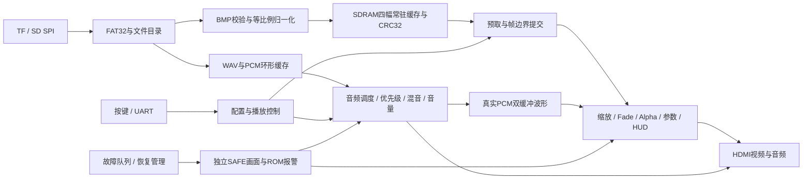

# 架构、模块与接口契约

## 分层与职责

生产顶层 [`safevision_v3_top.v`](../../../safevision/platform/anlogic_eg4s20_hx4s20c/rtl/safevision_top/safevision_v3_top.v) 负责装配，通用功能放在 `safevision/rtl/`；厂商 IP 和板级 I/O 放在 `safevision/platform/anlogic_eg4s20_hx4s20c/`。显式源清单选择生产实现，仿真行为模型不进入综合。

| 层 / 目录 | 责任 | 主要输入输出及验收入口 |
|---|---|---|
| B 存储：`rtl/storage`、`rtl/media`、`rtl/memory` | SPI、FAT32、目录、BMP/WAV、缓存、仲裁与 DMA | 字节流→规范像素/PCM；完整输入合法且写入/读回检查通过后，槽位才有效；完整卡、碎片、反压与坏文件测试 |
| A 显示：`rtl/video`、`rtl/hd` | 固定光栅、源帧读取、插值、Fade、Alpha、HUD、波形 | 坐标/像素、frame_start、有效性；独立逐像素全帧参考与最终 RGB 比较 |
| C 控制：`rtl/control`、`rtl/audio`、`rtl/safety` | 去抖、手势、事件队列、UART、配置、音频、故障恢复 | 事件/配置→请求、忙、完成/失败；公开时序对照、队列并发和故障注入 |
| 板级适配：`platform/.../rtl`、`ip` | PLL、SDRAM应用适配、FIFO、HDMI串行端、物理管脚 | 原厂端口和平台接口；GUI/CLI 一致性、物理 PAD、ROM/采样网表检查 |
| 工具与证据：`tools`、`verification`、`evidence` | 源身份、独立参考、语义负控、STA、追溯 | 只有正常结束及全部门槛满足才批准 |

## 时钟与复位

外部参考时钟为 50 MHz。生产顶层定义 BASE 像素名义频率 25,185,185 Hz，来自原厂 PLL 计数器；不要用理想 25 MHz 替代约束或误写成实测值。SYS/MEM 使用已验收 50 MHz 存储配置及对应 SDRAM 相位输出。视频、串行、音频频率和生成时钟关系以 PLL 源与 `v3_board.sdc` 为准，音频样本调度为 48 kHz。

| 域 / 复位范围 | 处理原则 |
|---|---|
| 参考时钟 / 配置周期 | `v3_boot_uptime` 从配置/上电建立新 epoch，50,000,000 周期加一秒；KEY1/媒体复位不清零 |
| SYS控制域 | 按键两级同步后去抖；配置跨 KEY1/媒体复位保留，配置/断电恢复默认；故障记录不能被视频/音频 PLL 失锁顺带抹掉 |
| MEM域 | SDRAM事务、预取与缓存握手；相关复位按当前原厂接口在下降沿释放 |
| PIX域 | 光栅、显示流水、OSD、波形双缓冲；状态以确认邮箱送入，在帧起点采用完整快照 |
| 音频域 | 接受的 PCM/ACR 与跨域 FIFO；可视化只旁路观测，不向播放链施加反压 |
| 媒体恢复域 | 可重置文件/媒体路径，SAFE光栅、ROM安全画面与报警通路继续存活 |

跨域总线使用保持数据的确认邮箱或异步 FIFO，不能对多位配置逐位同步。CDC 例外带最大物理飞行预算，审计实际对象和例外命中；不依靠大范围 false_path 掩盖真实路径。

## 数据、时刻与发布契约

- 流接口：`valid && ready` 才接受；反压期间生产者保持载荷/坐标。不得把读请求发出当成数据已返回。
- SDRAM应用：32 位数据、21 位物理字地址、4 位字节掩码；预取适配层隔离厂商响应延迟，保留事务边界和超时围栏。地址步进、读回拍数、掩码的独立测试见当前证据。
- 图像：RGB565 规范帧为 640×480。BMP BGR24 输入校验方向、填充和长度后等比例适配，黑边完整写入；行 CRC32/精确写入采样/读回检查均保留。
- 提交：图像、音频使用 generation；新媒体未准备好时不发布半帧。换帧只在约定帧边界提交；旧响应排空后才能清理下一 epoch。
- 显示：已有 OSD/字形通路按四拍绘制管线对齐。不同缩放和平台读接口各有固有延迟，不能据此推断所有模块统一四拍；接口测试按各自公开有效信号核对。
- 波形：取 HDMI 实际左声道、混音和音量后的 PCM，截取最高 8 位做 128 点快照，48 kHz 下约 2.67 ms；双缓冲完整后帧边界交换，画面每样本两列。它不是 FFT，也不是音量柱。
- 恢复：复位→释放→重扫→自检→重新提交；超时/失败返回 SAFE，最多三次。冷装载总预算 60 秒，重扫等待仍是 4.9 秒；最大尺寸卡可能超出恢复窗口，不能承诺此时不进入 SAFE。

源清单、约束、GUI 参数和 IP 依赖共同构成198项物理指纹；修改其中任何一项都建立新的物理验收边界。实现细节及精确端口以源码为准，[构建说明](BUILD.md)提供入口。
