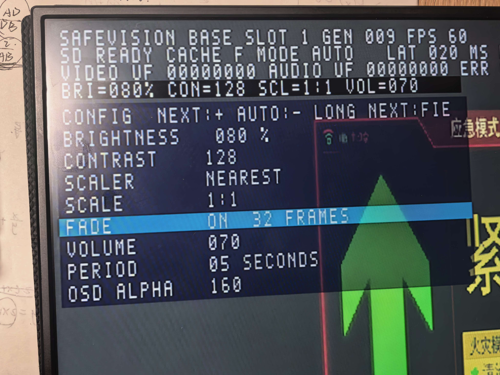

# 实体菜单与屏幕状态：BASE 26102301

本页逐项对照生产 RTL，说明用户提供的真实显示器照片。图片中的蓝色行选中 FADE；图像说明菜单呈现，不单独证明固件身份、声音或断电启动。固件身份与完整功能记录见 [验收记录](ACCEPTANCE.md)。

## 按键如何使用

| 操作 | 实体按键 | 作用 |
| --- | --- | --- |
| 进入菜单 | KEY2+KEY3 同时持续约 2 秒，实际操作按约 3 秒后松开 | 打开配置面板 |
| 增加/切换 | 短按 KEY2 后松开 | 对蓝色选中行增加数值或切换选项 |
| 减少/反向切换 | 短按 KEY3 后松开 | 对选中行减小数值或反向切换 |
| 选择下一行 | 单独长按 KEY2 约 1 秒后松开 | 八项依次循环 |
| 退出菜单 | 单独长按 KEY3 约 1 秒后松开 | 关闭面板，恢复轮播计时 |

画面中的 NEXT:+、AUTO:- 是逻辑按键名：NEXT 对应 KEY2，AUTO 对应 KEY3；进入菜单后分别作为加、减。菜单关闭时，KEY2 手动换图，KEY3 切换自动/手动播放。长按只触发一次，松开再按才会再次触发。

## 八项参数逐项说明

| 项目 | 照片中的值 | 实际控制内容、范围与按键步长 |
| --- | --- | --- |
| BRIGHTNESS | 080% | 图片像素亮度，0–100，短按每次变化 5；50 对应不加亮度偏移，80 对应 RGB888 通道约 +60 的偏移。不是显示器背光百分比，0 也不是关闭显示器。 |
| CONTRAST | 128 | 对比度增益，以 128 为原始增益 1.0；实体按键范围 64–255，每次通常变化 8，端点饱和。64 约为 0.5 倍，255 约为 1.99 倍。 |
| SCALER | NEAREST | 选择显示端最近邻或 BILINEAR 双线性插值。最近邻选邻近像素，双线性用相邻像素按小数坐标加权。整数坐标采样时二者结果可以相同。 |
| SCALE | 1:1 | 显示画布尺寸：1:1、FIT、1/2、1/4，按键循环。针对已经归一化的 640×480 画布，BASE 下 1:1 与 FIT 都是 640×480；1/2 为居中 320×240，1/4 为居中 160×120。 |
| FADE | ON 32 FRAMES | 换图渐变开关。ON 时以 32 个显示帧逐步混合前后两张图，约 60 帧/秒时约 0.53 秒；OFF 时在合法帧边界直接切换。32 帧为本版本固定长度。 |
| VOLUME | 070 | HDMI PCM 输出的数字音量，0–100，按键每次变化 10；0 静音，100 使用原始数字幅度，70 不是 70 dB，也不是人耳响度的严格 70%。频谱取音量处理后的实际左声道 PCM。 |
| PERIOD | 05 SECONDS | 自动模式每张图的稳定停留计时，2、5、10、30 秒循环。打开菜单会暂停并清除这次计时；退出后重新计时。启用 FADE 时，两次完成换图之间还包含渐变和帧边界等待。 |
| OSD ALPHA | 160 | 菜单文字/底板图层的不透明权重，0–255，按键每次约 16；160 约为 62.7% 前景、37.3% 背景。越大越不透明，0 时该层不可见。它不改变整张图片的 Alpha，也不调节声音。 |

亮度和对比度在各色彩通道上近似按 `输出 = 限幅((输入−128)×CONTRAST/128 + 128 + 2×BRIGHTNESS−100)` 处理，再转换为 RGB565；实际硬件包含整数舍入与端点限幅。过高亮度会使亮区饱和，过低会使暗区被截到黑色。

图片从 TF 卡导入时，先用整数最近邻等比例归一化到 640×480，并补黑边；菜单 SCALER 是后续显示端的插值选择。它不会恢复导入阶段已经丢失的细节。在 BASE 的这些整数缩放坐标下，切换插值选项不保证每张图片都有肉眼可见差异。

OSD ALPHA 设为 0 后，菜单仍可能处于打开状态。若已选中最后一项，短按 KEY2 可以增加 Alpha 使其重新显现；如需恢复启动默认配置，可用 CONFIG1 从本次已固化 Flash 重新加载。普通 KEY1 媒体复位可能保留配置，不能把它写成无条件恢复默认的操作。

## 顶部状态不是菜单参数

| 显示 | 含义 |
| --- | --- |
| SAFEVISION BASE | 当前显示为 BASE 640×480 处理模式；显示器可以再把该信号放大到自身面板尺寸。 |
| SLOT 1 | 当前显示缓存槽，四槽轮播。 |
| GEN 009 | 已提交的媒体 generation 计数；用于绑定同一次图片/伴音切换，不是文件名或图片总数；8 位计数会回绕。 |
| FPS 60 | 实际测得的帧率，约每秒 60 帧。 |
| SD READY | 媒体加载已准备好，需与串口完整性/错误计数共同判断。 |
| CACHE F | 十六进制 F 等于二进制 1111，四个图像缓存槽都有效。 |
| MODE AUTO | 自动轮播已启用；这里的 AUTO 不是自动调节显示器背光。菜单打开期间仍会暂停轮播计时。 |
| LAT 020 MS | 系统统计的控制响应到画面提交延迟指标；不是整条 HDMI 线或显示器面板延迟的测量。 |
| VIDEO UF / AUDIO UF | 视频/音频供数不足计数；照片中两项为 00000000。右侧被裁切的 ERR 不能据此判断其全部内容。 |
| BRI / CON / SCL / VOL | 当前亮度、对比度、画布比例、音量的快捷回显，与菜单对应。 |

左下 UP … s 是 FPGA 配置/启动后的累计运行秒数，不是日历时间。右下频谱使用 512 点 FFT 与 32 个频段显示实际输出音频的频率分布；纯音集中在少数频段是正常现象。

## 对应源码

- [按键、范围、步长、菜单及轮播计时](../../../safevision/rtl/control/v3_user_controls.v)
- [菜单数字、行选择和 Alpha](../../../safevision/rtl/video/v3_status_layers.v)
- [BASE / HD 坐标与画布尺寸](../../../safevision/rtl/video/scaler/scaler_coords.v)
- [亮度与对比度运算](../../../safevision/rtl/video/video_compositor/color_adjust.v)
- [任意名称图片、配音与频谱架构](../../architecture/flexible-media-and-spectrum.md)
