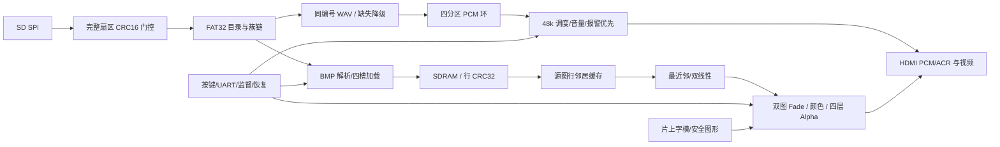

> 历史阶段记录，版本、参数与结论按原记录日期理解。当前 BASE 的模块和验收状态见仓库首页。

# 系统与模块契约

## 时钟与数据流

V3 使用独立 50MHz / +8ns 内存 PLL，按厂商原语模板设置参数并附 IPC。官方模型验证频率与相位，原生 derive_clocks 作独立核对；该配置未通过 GUI 自动生成。旧工程仍保留 40MHz 配置。

REF 50 MHz 负责 SD SPI/FAT/BMP/WAV；SYS 100 MHz 负责按键、UART、配置与故障；V3 MEM 50 MHz 负责 SDRAM 仲裁、缓存校验、行预取、PCM 环；PIX 为 BASE 约 25.175 MHz / HD 74.25 MHz；AUDIO 约 12.288 MHz，以 256 分频送 48 kHz 采样。HDMI 串化时钟来自模式对应的官方 PLL。

## 存储布局

所有地址为字节地址。IMG0/1/2/3 起点为 `0x000000/0x0A0000/0x140000/0x1E0000`，各预留 640 KiB；每幅源图固定 640×480 RGB565，有效载荷 614400 字节。PCM 环从 `0x280000` 起，256 KiB，四轨各 64 KiB、每个立体声样本对占一字。工作区 `0x2C0000..0x3FFFFF`；存储接口当前开放 4 MiB，不能借用物理剩余容量绕开地址检查。

## 责任边界

| 层/模块 | 时钟及复位 | 接口和完成条件 | 验证入口 |
|---|---|---|---|
| `storage/sd_checked_sector_reader` | REF / media | 完整 512 字节及 CRC 收齐后才发布；CRC 错误零 payload；输出在反压期间稳定 | checked_sector / final_crc |
| `storage/sd_bmp_player` RESIDENT_CACHE=1 | REF / media | 有序扫描，跳过坏 BMP，跨候选批次重扫；四幅合法图批准后停止图片 SD 读取，向 WAV 开放扇区口 | resident |
| `bmp_frame_sink` RESIDENT_LOAD=1 | REF→MEM / media | 正规厂商 FIFO；写入、排空和读回都完成，才能向 player 确认 | resident / B sink |
| `memory/v3_row_integrity` | MEM / media | 写前 CRC32 与实际 SDRAM 每行 320 字读回比较；四槽 1920 行标签；校验通过才 approved | row_integrity |
| `video/v3_line_cache` | MEM↔PIX / media | 行描述符握手，生产十RAM打包路径使用相关 SYS100 时钟拆分写入；最后半字写回执与 CRC 双条件后发布；默认通用路径仍支持随机坐标。行复用降低 HD 读带宽 | video cache/full |
| `scaler_coords/scaler_bilinear` | PIX / global | 坐标 2 拍、取 RAM 1 拍、双线性 3 拍；夹紧 639/479 边界；HD 4:3 图居中 960×720 | math / coords / full |
| `alpha_blend/color_adjust` | PIX / global | 混合每层 3 拍，精确四舍五入除 255；亮度有符号，RGB565 饱和；颜色 2 拍 | math / color |
| `video/v3_status_layers` | PIX / global | 字幕、菜单、故障字形、真实状态和能量条；全部 4 拍；独立 SAFE 字模不依赖媒体存储 | layers/full |
| `storage/v3_wav_source` | REF / media | 完整根目录匹配四图 BCD 编号，支持碎片链、RIFF chunk 奇数字节填充、扇区边界半PCM上下文；仅合法 48k/16bit/双声道 PCM，坏轨独立使用 ROM 提示音降级 | audio_wav/errors |
| `audio/v3_pcm_ring` | REF/MEM/AUDIO / media | 四轨独立读写指针；每轨 16384 对；新提交严格按 slot/generation 取样，旧代数据不得成为输出 | audio_ring/system |
| `audio/v3_audio_system` | 五域 | 提交前至少 800 对预取；有界启动等待后记录真欠载；16bit PCM 左移 8 位对齐到 HDMI 24bit | audio_system/underflow |
| `audio_priority_arbiter` | AUDIO / global | 报警 ROM 优先，240 个采样点完成 5ms 切换；媒体复位期间报警持续 | C audio / audio_system |
| `audio_energy/hdmi_acr` | AUDIO / PIX | 1024 样本能量；N=6144，CTS 根据 48 样本窗口实测像素时钟计数 | energy_acr/system |
| `control/v3_user_controls` | SYS / global | 配置单一写入者；去抖、释放动作、组合长按、UART 原子提交；转场忙时 NEXT 返回忙 | controls/uart_link |
| `control/v3_supervisor` | SYS / global | 原因及毫秒时间戳、故障等级、心跳超时；有限复位/释放/重扫/验证，最多 3 次失败恢复尝试 | supervisor/C/recovery |
| `memory/v3_aux_mux` | MEM / media | 校验与音频共用辅助端口；owner 保留到事务完成，读回应不得串轨 | aux mux |
| 板级 `safevision_v3_top` | 全部 | 只装配、复位分域、CDC、遥测、引脚与官方 IP；遗留顶层可独立构建 | board integration / TD |

## 提交、时钟域与复位

视频固定扫描始终运行，最终输出坐标、DE、HS、VS 与 RGB 固定对齐 21 个 PIX 时钟。转场只在垂直空白改变配置/帧代号；默认 Fade 32 帧。音频 ready 必须匹配同一 target generation，最终帧提交携带 slot/generation 通过确认式 mailbox 传给音频。等待不能无限延长，超时进入 SAFE。

多位状态通过 `video_cdc_mailbox` 的握手包传输，不能逐位两级同步。单比特电平经同步器；采样流使用 TD 官方异步 FIFO 封装。媒体复位同时建立 REF/MEM/SYS 的新 epoch；控制状态、安全图形、固定扫描和报警音只接受全局复位。PLL 丢锁可使对应物理输出失效，存活 REF 域保留灯/串口诊断，不能宣称这种故障下 HDMI 仍能正常显示。

目录扫描器 `SV_MEDIA_ONLY=0` 保持通用8.3目录枚举合同；V3共享文件系统实例显式设为1，只发布本应用本来接受的 `SVdddd  BMP/WAV`（四位ASCII十进制数字）。名称以16位数字和扩展名位保存，发布时重建88位接口；32位簇号、32位长度和原始槽位索引不缩窄。该参数不改变坏项跳过、停止标记或背压保持规则。
