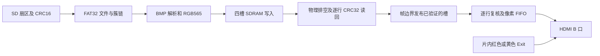

# 26101003：SD 图片无法显示与连续播放花屏排查说明

本轮目标是修复正常 SD 图片链路，保留黄色/红色 Exit 的独立安全显示，并把可重现的源码、测试、时序报告和位流一起交付。开发板目前未连接，实板验收状态必须保留为“待验收”。本文不能作为“上板必然成功”或全部赛题已完成的证明。

## 1. 串口给出的直接证据

用户提供的是 26101002 的输出，而不是本轮 26101003：

```
SV-PLAY ST=A FS=7 EC=F3 SD=0 CARD=0 CNT=4 CUR=0 RD=000E1036 PX=4B000 F=0000 SLOT=1 CRC=0 ED=01 R1=00 SQ=4
SV-MEM ID=26101002 PH=3 BAD=000A0000 EXP=0D968558 GOT=FEA8A821 W=00025800 B=0000
```

- CNT=4：目录已经找到四个候选文件。
- RD=0xE1036=921654：第一幅 BMP 的 54 字节头和 921600 字节像素载荷已读取。
- PX=0x4B000=307200，W=0x25800=153600：像素数量和 32 位写字数完整。
- BAD=0xA0000：失败在第一个目标帧槽的起点。
- B=0：第一个校验块就失败；帧没有提交，F=0 是正确的失败保护。
- PH=3、EC=F3：存储写后读回完整性检查失败。SD=0/CARD=0 是错误状态撤销播放许可后的结果，不能据此倒推“卡一开始就没初始化”。

旧版每块 64 个 32 位字，即 256 字节。用独立的 Python zlib 算法复算：256 字节全 00 的 CRC32 是 0D968558；256 字节全 FF 的 CRC32 是 FEA8A821，恰好与用户的 EXP/GOT 相同。这不是凭图片猜测，而是确定的校验值对应关系。仍需实板复测区分软件缺陷修复后是否还存在电气、供电或器件时序问题。

LED1 表示基本时钟/SDRAM 初始化，LED4 主要反映 HDMI/显示链路健康，不能代表 SD 图片已验证成功。红色 Exit 走片内安全图形链路，正常照片依赖 SD→解析→SDRAM→读回→视频搬运；因此“Exit 正常、照片失败”与上述日志一致。

## 2. 找到并修复的 SDRAM 掩码缺陷

真实 SD 产出较慢，写适配器会在 48 个 MEM 空闲周期后刷新一个单字写。官方接口要求合法连续写拍，所以单字后补一个被 DM=F 完全屏蔽的相邻字，避免覆盖邻居。这项屏蔽必须保留。

旧适配器在补拍后把 App_wr_dm=F 一直保留到下次写。由 TD 导出的官方综合网表可以追踪到：DM 持续经过寄存器送往 SDRAM 的 DQM，并非只在 App_wr_en=1 时才生效。DQM 同时屏蔽读输出，持续为 F 会让后续读回采到上拉的全 FF。

修复是正常周期默认 App_wr_dm=0，只有实际写拍才覆盖成该拍的掩码；保留单字补拍 DM=F，并保留至少 16 个安静周期，排空控制器/DQM 流水后再读。没有改写官方加密 IP。

负向实验使用 cbbe531 基线的旧适配器，慢速稀疏写后重现 FEA8A821；新适配器返回 0D968558，并检查被屏蔽的相邻字保持原值。新增模型补上读 DQM 的延迟屏蔽，而不再只模拟写掩码。模型仍是接口行为模型，不能替代官方加密控制器和真实 SDRAM 的电气仿真。

原理参考：[Etron EM638325 原厂数据手册](https://etron.com/wp-content/uploads/2022/04/EM638325_Rev-3.2.pdf)，DQM 的读屏蔽延迟为两个时钟。这里引用相同 2M×32 几何的 SDRAM 行为；没有证据证明开发板内嵌存储器的实际芯片就是这个型号。

## 3. 文件正确到显示正确之间的提交条件



这也解释了为何 Exit 能显示，而 SD 照片失败：安全图形没有经过读卡和 SDRAM 图片写入链路。

新帧满足以下全部条件才能显示：当前文件流确实启动过；文件全部输出并排空；最后一个 SD 扇区的 CRC16 通过；307200 个像素完整；写事务物理排空；全部 480 行写后读回 CRC32 通过；最终在帧边界完成换帧确认。

不能只看像素计数。BMP 最后一个扇区的剩余填充字节和 CRC 在最后一个像素之后才能读完，原 file_streamer 的 done 也不能单独证明尾部 CRC 已通过。新 source_stream_ok 必须等 reader 回到空闲且没有 CRC/超时/解析错误；还必须见过当前文件的 busy，防止上一个文件残留的 done 电平误批下一文件。

这个许可经过两级同步送到接收器。接收器在写入和等待提交两个状态都优先处理 abort。内存校验器同样让 abort 优先于验证请求、响应和状态推进，并撤销目标槽的批准。坏文件只会排空、局部复位媒体传输模块并继续查找，不发布、不增加成功计数，也不破坏已校验的其他帧。

## 4. 四幅常驻、坏图补位与切换

四槽仍使用冻结的字节地址 0、0xA0000、0x140000、0x1E0000。每幅 640×480 RGB565 净数据 614400 字节；每槽保留 655360 字节；四幅净数据 2457600 字节，槽区预留 2621440 字节，不占用后面的音频环和工作区。

第一幅合法图验证后先显示，其他合法图在后台写入另外的槽。所有背景帧也做完整读回校验，但不改变当前显示。最多缓存四幅，之后手动/自动切换只传递槽号与代次，不重新读卡、不重写正在显示的槽。

索引按 SV0001.BMP 到 SV9999.BMP 的数字后缀排序，每次取最多四个候选。坏图不占常驻槽；候选窗口用完而合法图还不足四幅时，以已处理的最大编号为边界再次扫描根目录，继续处理后面的候选。边界单调递增，目录结束就停止，不会反复遇到同一个坏图。常驻槽按验证成功的文件编号顺序压紧排列。

卡里只有一到三幅合法图时保留这些图并按实际数量切换；没有合法图则进入错误状态。CNT 的最终值为成功缓存的数量，CUR 是缓存序号，不等同于文件名中的四位编号。支持范围仍是 FAT32 单分区/卷、根目录 8.3 编号短名、640×480、24 位未压缩 BMP、正负高度及标准 BGR 转 RGB565。exFAT、JPEG、任意分辨率与长文件名不是本版支持范围。

接收器的像素停顿容限改为 250 ms，超过读卡层 200 ms 的数据令牌等待；写入无进展容限为 500 ms。播放器 3 秒看门狗改为无进展计时，不能因为一张合法图片累计读取超过 3 秒就中止。测试实际插入 10 ms 数据停顿，验证不会再被旧 4 ms 条件误判。

按键增加约 21 ms 消抖。短按自动键切换自动播放开/关；长按约 1 秒只改变 2/5/10/30 秒周期，避免同时触发开关；手动切换和正在换帧时重新计时。成功帧计数饱和于 FFFF，避免长时间轮播后回绕到 0 又触发初始化播放。

本轮追加的完整四图回归发现了二次扫描的完成状态误用：扫描器的 `scan_done` 保持为 1，直到接收下一次 `scan_en` 才清零；播放器原来会把这个旧的完成状态当成本窗口完成，导致第五个合法文件未加载。已在清索引、发启动之后，先等 `scan_done=0` 的接收确认，再等本次 `scan_done=1`，并保留等待超时。新增 `tb_player_scan_epoch` 定向测试覆盖旧完成不能提交、新完成才能提交、原有槽保留、缺失第四图继续选择以及不应答的有界退出；最终位流在修复后重新构建。发现该失败的开发运行没有归档为通过结果，也没有上传成最终候选。

## 5. CRC 存储与读带宽

每幅按 480 行保存 480 个 CRC32，四幅共 1920 个签名，使用 2048 项容量。视频读端以每行 320 个 32 位字为校验单元，整行通过后才给像素 FIFO，不能把未校验的部分行直接送到屏幕。非二次幂的 320 字长度使用正确的填充银行寻址，不能按 640 连续数组去拼二进制索引。

这让四图常驻的校验表可在本板片内 RAM 资源中实现。640×480 RGB565 在 60 Hz 时的图像载荷为 36.864 MB/s；720p 版本居中显示同样 640×480 图像，边框由视频逻辑输出黑色，不把 1280×720 全屏都作为照片从 SDRAM 搬运。实际吞吐仍取决于控制器刷新、读写间隔和响应延迟，仿真通过不代替实板水位测量。

## 6. 板级性能、引脚与“负 5 ns”

依据 HX4S20 开发板手册及实际约束，晶振为 R7 的 50 MHz；TF 接口为 A12/CS、A14/SCLK、A13/MOSI、B14/MISO，MISO 上拉；UART TX 为 D12；HDMI 使用 B 口 G5/F1/E1/C3 和 DDC P2/R2。板载资源为 EG4S20BG256、19600 LUT、64 个 9K BRAM、2M×32 SDRAM。当前不是此前的 125 MHz MEM 档，而是 SYS 100 MHz、MEM 40 MHz、SDRAM 时钟带相位偏移的实际 PLL 配置。

SD 初始化使用 100 kHz，数据 SPI 使用 12.5 MHz，按真实 50 MHz 域计算，没有用仿真加速时钟当作上板速率。初次读取四幅图需要时间，第一幅通过完整校验后才显示；之后切换使用常驻缓存。

“−5.08 ns”如果是 setup slack，表示数据比要求晚约 5 ns，是违例，不是正常延时。当前没有用户对应路径报告，不能认定它每次必然存在，也不能认定是官方 IP 无法修复。历史 125 MHz 工程存在 SDRAM 边界负裕量，与官方器件/工程必坏不是同一结论。

本版采用实际降频和相位配置，优化读预取及完整性签名容量，保留真实数据路径的单周期约束。新增控制信号只对第一级跨域同步寄存器设置例外；第二级及业务逻辑继续检查。没有加整组时钟 false path，也没有使用 ExperimentalSdramBitgen 放过负裕量。720p 初次路由出现 7 条微小保持违例，最差 -0.012 ns。按 TD 官方 doc/scripts/MultiSeed.tcl 使用独立 fix_hold 后，这份路由的 HWNS 变为 +0.010 ns，SWNS 保持 +0.303 ns。已将该阶段加入 td_flow.tcl，在每次 route 之后、最终报告之前修复实际布线；最终交付以重新完整构建的双模式严格门禁为准，数字见下方验证表。

仍需承认边界：报告中外部 SPI/UART/HDMI I/O 没有完整的实测输入/输出延迟预算，工具内部闭合不能证明外部器件采样窗口。需要实板核对 SCLK/MOSI/MISO 波形、SDRAM BIST、冷启动、多个卡和显示器；若实测 SPI CRC 错误，可把 PLAYER_SPI_FAST_DIV 改为 3/7 分别降到 6.25/3.125 MHz，重新构建和验证。不能通过删约束或屏蔽错误让屏幕“看起来正常”。

最终原生时序报告中，720p 像素时钟为 74.167 MHz、串行时钟为 370.920 MHz，接近标准 74.25/371.25 MHz；模型检查的是 1280×720 帧几何与数据链，真实显示器对这个 PLL 频率组合的兼容性尚未实测。BASE 使用现有官方低分辨率 PLL 配置。

两份原生报告均以实际布线结果检查慢角和快角，报告 STA 覆盖率为 99.99%，工具默认时钟不确定度为 0.100 ns。这不是“所有路径及所有外设时序都已经完美”的结论；尤其 720p 最小裕量较小，需要保留原约束及最终布线，不能在改源码或重新路由后继续沿用旧位流的通过记录。

两种模式的实际 LUT、BRAM 和 DSP 用量见最终 `sta/BASE/route.area`、`sta/720p/route.area`。新增功能仍需重新布局布线，不能以剩余容量代替时序验证。

## 7. PDF A/B 验收边界

手册第 14.1/14.2 节分别是 A 显示链与 B 数据链，比赛条款 B01/B02/B03/B04 是另一套编号，不能混淆。

|要求|本轮证据|仍需实板/其他链确认|
|---|---|---|
|A：计数/消抖/时序/图案/字模/OSD|现有真实 RTL 单元回归；新增短按长按控制测试|字模位置和画面录像；普通播放顶层的 OSD 配置默认关闭，不能宣称现场菜单已交付|
|A：FIFO、CDC、预取、像素与 de/标记对齐|实际官方 FIFO RTL、读端及 AXIS 整帧逐像素比较|ChipWatcher、水位实测、1000 次实板事件证据|
|A：应急 MUX 与 HDMI|红/黄安全图形、帧边界切换和 HDMI 接口回归|官方加密 HDMI PHY 动态验证、两台真实设备兼容性|
|B：SPI、初始化、扇区、超时、FAT32、BMP|B 回归及实际速率完整卡到显示测试|实际卡的扇区转储与 PC 512 字节比对|
|B：SDRAM、仲裁、四槽、换帧|DQM 正负实验、四图及坏图补位、读回/播放 CRC、严格 STA|真实 SDRAM BIST、温度/供电角落、掉卡录像|
|比赛 B01|排序扫描、坏图跳过继续寻找四幅、固定图片格式|多种真实 FAT32 卡及碎片簇链上板记录|
|比赛 B02|BASE/720p 模型整帧检查、内部 STA|连续 1 小时、至少 10 次冷启动、真实无花屏/欠载|
|比赛 B03|两键手动/自动及 2/5/10/30 秒控制测试|实际按键操作录像；C 层菜单/状态显示还须集成确认|
|比赛 B04|没有新增音频实现|顶层 I_audio_valid 仍为 0，HDMI 音频没有完成，不能记通过|

白板问答、队员复核签字、不可移动版本 tag 和实板照片属于手册的验收要求，本轮不会替用户伪造。尚未接板不能把整份 PDF 的全部项目登记为通过。

## 8. 下载与验收顺序

使用本轮交付目录中的 BASE/safevision_top.bit 作为第一次下载候选，HDMI 接开发板 B 口。不要从历史目录选 26101002 或 SDRAM-only loopback 位流。

卡格式为 FAT32，根目录放四幅已检查的 SV0001.BMP 到 SV0004.BMP，均为 640×480、24 位未压缩 BMP。开机先允许完整预加载，不在尚未完成初次读卡时反复复位。串口设 115200、8N1，看到 SV-MEM ID=26101003 才能确认版本。本版 SV-MEM 增加 RAW，记录失败块的第一个实际读回字。

依次验收第一幅稳定显示、后台缓存完成 CNT=4、手动循环四幅、自动开关与长按周期、缓存完成后拔卡继续切换、黄色/红色 Exit 与恢复、至少十次冷启动和一小时连续播放。若失败，保存完整两行 SV-PLAY/SV-MEM、下载文件 SHA256 和实际卡格式。PH/BAD/EXP/GOT/RAW 可以定位是源文件、存储读回还是运行时显示 CRC，不能只看 LED 判断成功。

首次冷启动且尚未操作切图按键时，等待多条串口输出稳定为 `ST=7`、`FS=0`、`CNT=4`，成功帧计数 `F` 至少为 4，再开始缓存切换验收。预加载期间 CNT 可能仍是候选窗口数量；单独看到 CNT=4 不能证明四幅都已读入和验证。B2 为下一幅，C1 为自动播放；短按 C1 启停自动播放，长按约一秒只改变周期，A2 为全链路复位，B1 为手动应急输入。实际按键请按板卡引脚及本工程接线核对。

后续现场结果到来后按证据继续排查，不把本次模型通过写成已经实际显示成功。

复测入口均在 `safevision/tools`，XSim 使用 Vivado 2018.3，TD 使用 6.2.1 Engineer；XSim 的运行目录必须是纯英文绝对路径。三个关键端到端用例的参数如下（每行通过 `run_card_display_xsim.ps1` 调用，分别选择独立 `-RunDir`）：

```powershell
-Case card -ResidentFrames -ProductionSpi -FirstImageOnly -ReadLatency 11
-Case card -ResidentFrames -StressSdClock -ReadLatency 7 -BadImage 1 -ExtraFile
-Case card -ResidentFrames -StressSdClock -ReadLatency 11 -HD 1 -BmpTopDown 1 -BadTailImage 1 -ExtraFile
```

前一项保留产品初始化速度和 12.5 MHz 数据 SPI；后两项加速 SD 时钟以缩短测试时间，不能冒充实际电气速率测试。负向 DQM 实验保留旧适配器源文件，正向入口为 `run_sdram_dqm_xsim.ps1`；新增控制、四槽逐行完整性和索引窗口的入口为 `run_resident_unit_xsim.ps1`。现有 B/A 功能回归分别使用 `run_b_xsim_compat.ps1`、`run_a_stage11_15_sim.ps1` 和 `run_a_stage16_20_sim.ps1`。原始日志、编译输入指纹和观察结果随本版本归档。

完整原生构建使用 `run_board_sta.ps1 -Mode base,hd`，先完成两个模式的严格时序门禁，再生成位流。GUI 工程准备入口是 `prepare_board_project.ps1`；它只准备工程，不会替代 STA、生成验收记录或下载开发板。

### 修改文件与责任

以下路径均相对项目根目录；实际交付源码位于 `D:\Safe_Vision_FPGA_2026`。

|文件|本轮修改|
|---|---|
|`safevision/platform/anlogic_eg4s20_hx4s20c/rtl/sdram_app_adapter.v`|空闲 DQM 清零，保留写掩码与读写间隔|
|`safevision/rtl/storage/sd_bmp_player.v`|四图常驻、坏图排空、媒体局部复位、尾部 CRC 提交许可、二次扫描握手和无进展超时|
|`safevision/rtl/storage/file_index.v`|编号排序后按单调边界继续查找候选，供坏图补位|
|`safevision/platform/anlogic_eg4s20_hx4s20c/rtl/bmp_frame_sink.v`|跨域接收完整许可、物理排空、背景加载不发布、缓存选择等待确认、错误优先撤销|
|`safevision/rtl/memory/frame_integrity_guard.v`|四槽、整行 320 字 CRC、1920 项签名及 2048 项物理容量、RAW 诊断|
|`safevision/rtl/memory/video_read_dma_checked.v`|完整行通过后输出，适配非二次幂行长的缓存寻址|
|`safevision/platform/anlogic_eg4s20_hx4s20c/rtl/safevision_top/safevision_top.v`|连接新增许可与四槽参数、短按/长按自动播放控制、UART 版本 26101003 及 RAW 字段|
|`safevision/platform/anlogic_eg4s20_hx4s20c/project/board_verify/board_cdc.sdc`|新增慢控制信号只放宽第一级同步入口|
|`safevision/platform/anlogic_eg4s20_hx4s20c/project/board_verify/td_flow.tcl`|路由后执行官方 fix_hold，再生成最终时序报告和位流|
|`safevision/verification`、`safevision/tools`|增加 DQM 读屏蔽、四槽/坏图/尾部 CRC/扫描握手/按键回归与可复测入口；修正测试接口位宽|

本轮没有修改 `safevision/rtl/video`、`safevision/rtl/top`、`safevision/rtl/control`、`safevision/rtl/audio` 中的队友模块；板级连接变更在 platform 顶层完成。原有本地修改会备份和暂存，不通过清空目录或覆盖历史位流来同步。


## 9. 最终同版本验证结果

|项目|结果|
|---|---|
|contract|17 个仿真用例通过；原始日志见 simulation/contract|
|resident_units|3 个仿真用例通过；原始日志见 simulation/resident_units|
|dqm|6 个仿真用例通过；原始日志见 simulation/dqm|
|b|28 个仿真用例通过；原始日志见 simulation/b|
|a11_15|9 个仿真用例通过；原始日志见 simulation/a11_15|
|a16_20|6 个仿真用例通过；原始日志见 simulation/a16_20|
|a1_9|5 个仿真用例通过；原始日志见 simulation/a1_9|
|base_refill|1 个仿真用例通过；原始日志见 simulation/base_refill|
|hd_tail|1 个仿真用例通过；原始日志见 simulation/hd_tail|
|production|1 个仿真用例通过；原始日志见 simulation/production|
|总计|77 个正向用例通过，另有 DQM 历史缺陷、计数器变异和二次扫描握手三个负向实验|
|BASE 布局布线|SWNS=0.635 ns，HWNS=0.027 ns；负路径 0，内部严格门禁通过|
|720p 布局布线|SWNS=0.107 ns，HWNS=0.024 ns；负路径 0，内部严格门禁通过|

生成位流前后重新核对全部板级输入、约束和官方 IP 的哈希；没有使用带负裕量的实验性放行。开发过程中的中断、旧输入快照或未结束运行未进入这张通过表。

真实 SPI 速率、BASE 四图补位和 720p 尾部 CRC 拒绝用例均在扫描握手修复后重新运行。真实速率首图测试与初始化测试的原始测试文件按编译哈希保存在 simulation/production/inputs；其 FIRST_ONLY 路径没有变化。四图完整回归使用交付的最新测试文件。所有板级 RTL、约束、IP 与最终位流的输入一致。

完整回归还发现测试接线错误：卡模型的 8 位命令计数被接到 32 位线，高位在 XSim 为 Z，导致相等比较为 X；独立小仿真已复现。已修正位宽，并改为独立累计命令事件计数，避免 8 位回绕隐藏新命令；同时分别检查命令数与实际图像写入次数。修正后的 BASE、720p 完整流程重新运行，未把此前失败日志改写为通过。原始失败与复现见 simulation/fixture_correction。

- BASE/safevision_top.bit：642439 字节，SHA256 `6625416e03dc7f610c515d15f4a6918529002be7eb155557e088eb88bfbce6fd`。
- 720p/safevision_top.bit：642439 字节，SHA256 `1e6ca0de37c3c4f7e44aa03c2b895e2d9721b6a3eaaf0429fae08cc8a77096f1`。

完整测试输入指纹见 `verified_inputs.json`；构建输入指纹及原始时序报告在 `sta/`；本次硬件状态仍为未连接、未下载、未验收。
